# PumpDump (Pumpwatch)

Real-time detection of coordinated pump-and-dump activity for retail investors.
Pumpwatch watches social chatter, news, SEC filings and market data together,
and flags tickers where hype is rising without a real catalyst behind it.

The dashboard brings together risk scores, stock news, gainers/losers, observed intraday
swings and pretrained Bluesky sentiment. The output is a risk signal with its evidence,
not buy or sell advice. Sentiment describes sampled text; it does not predict returns.

## Screenshots

All images come from a production build run with mock data (`DATA_MODE=mock`): no API keys, no backend, and every figure shown is invented for the demo. The screens are labelled MOCK where they show a figure. No real market data appears in any image.

### Landing page

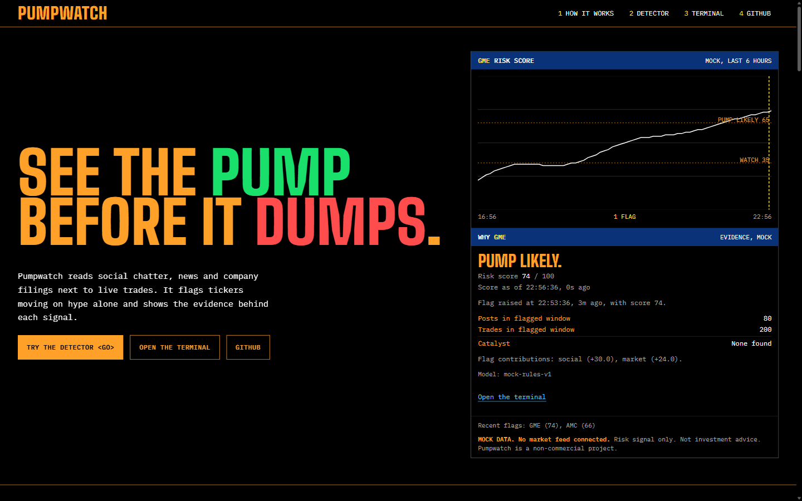

The hero splits 7 to 5: the headline on one side, a terminal panel with the risk score chart and the evidence behind the latest flag on the other.

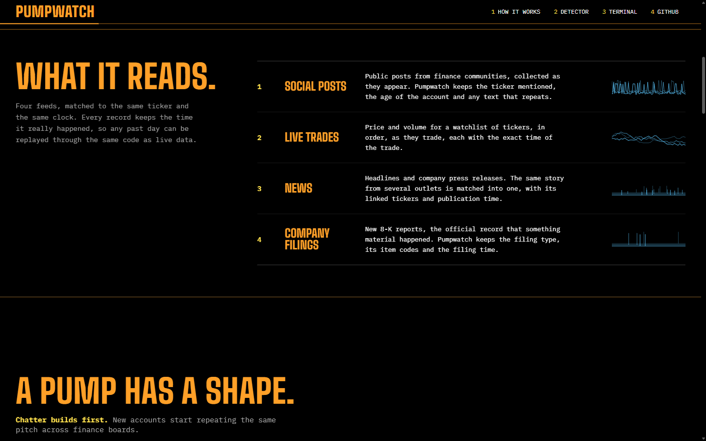

The four feeds Pumpwatch reads, matched to the same ticker and clock.

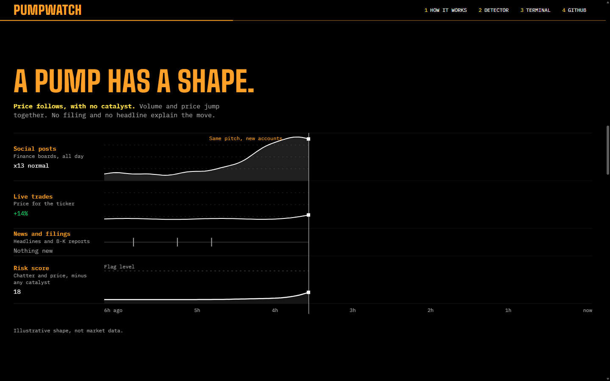

Scroll story, step one: chatter builds first while the news row stays empty.

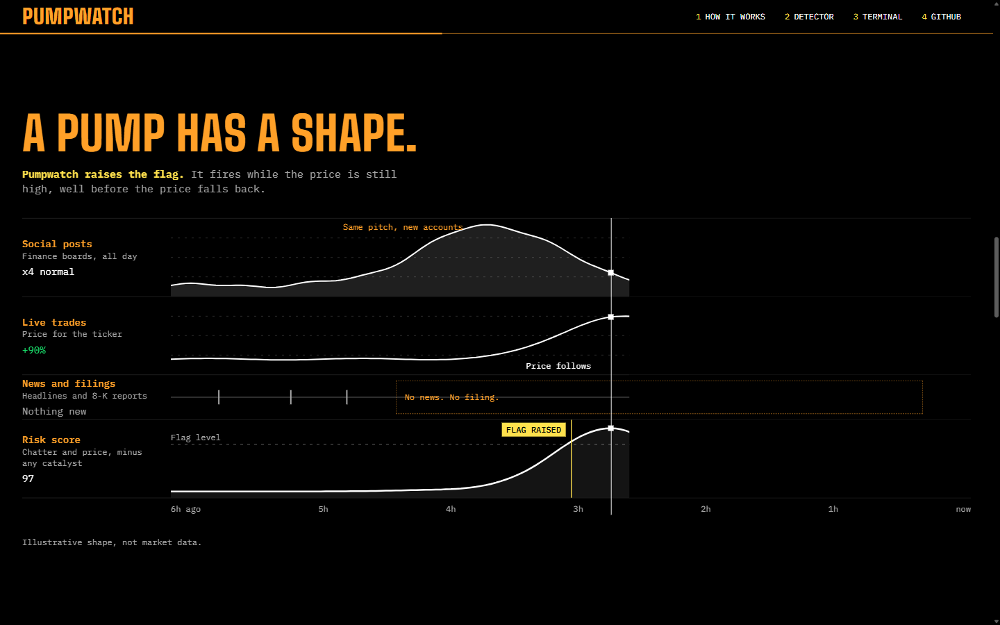

Scroll story, final step: the risk score crosses the flag level and the flag is raised.

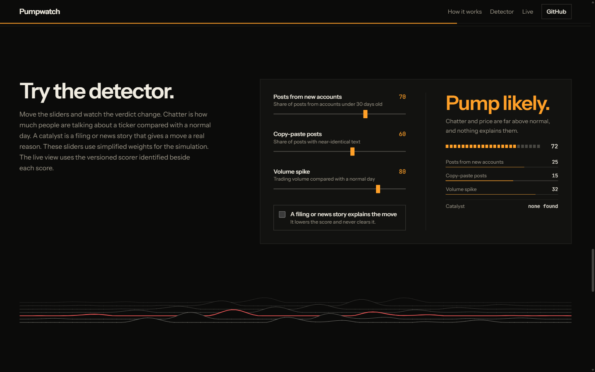

The interactive detector with hype-only inputs gives a Pump likely verdict.

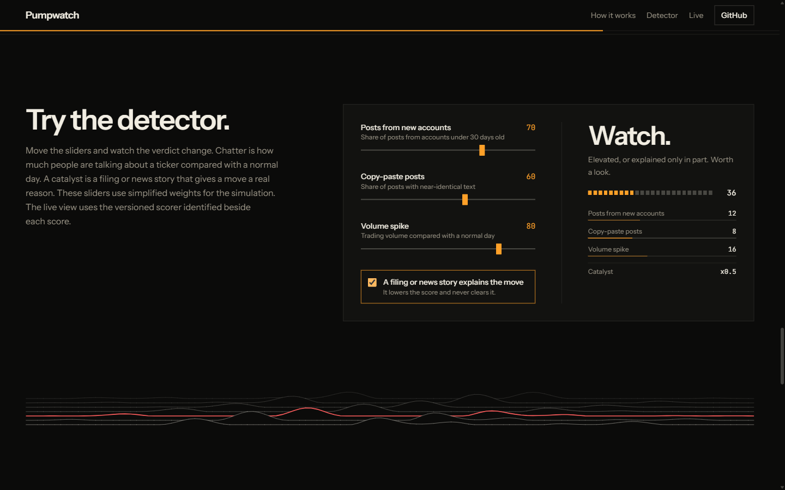

Ticking "a filing or news story explains the move" lowers the same score to Watch.

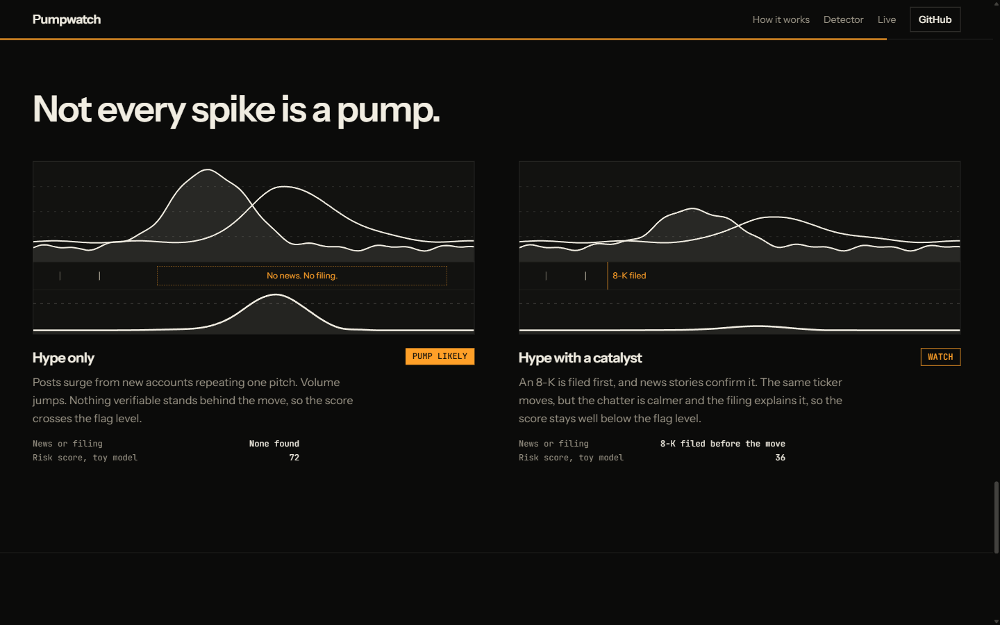

Not every spike is a pump: the same chatter with an 8-K filed first scores lower.

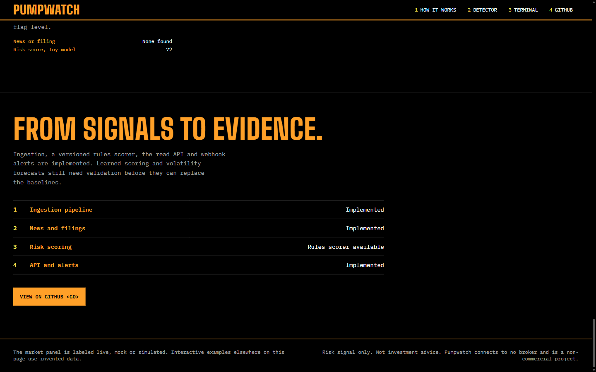

Project status and the footer disclaimer.

### Terminal (`/live`)

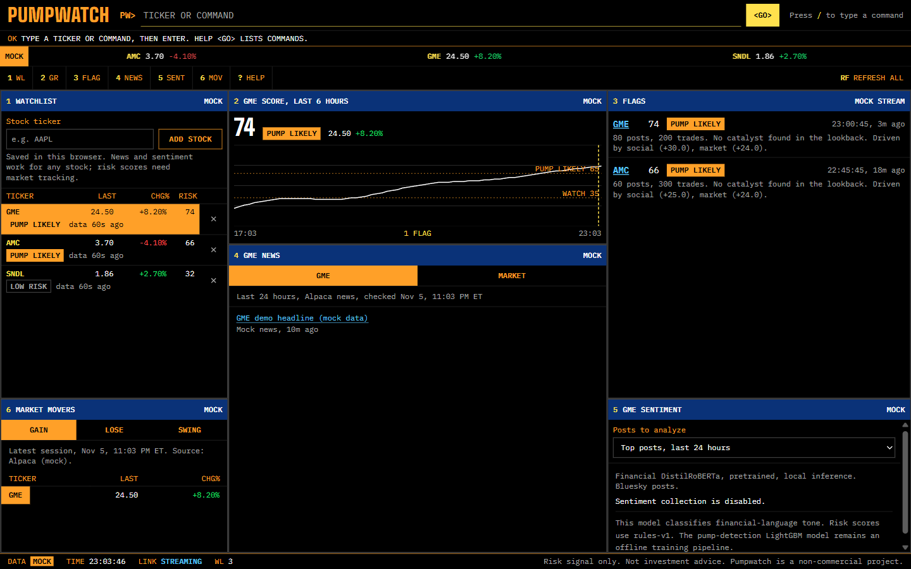

The terminal fills the screen: a command line, a ticker strip, numbered panels (1 watchlist, 2 score chart, 3 flags, 4 news, 5 sentiment, 6 movers, 7 assistant; the screenshots below predate panel 7) and a status line with data mode, clock and link state.

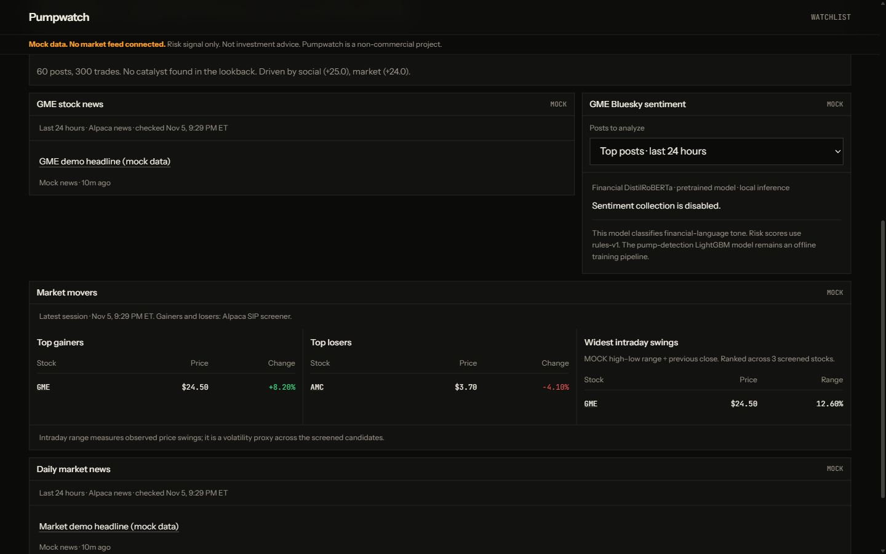

Typing `MOV` and pressing Enter jumps to the movers panel and highlights its title bar. News, sentiment collection (off in mock mode) and movers are in the same view.

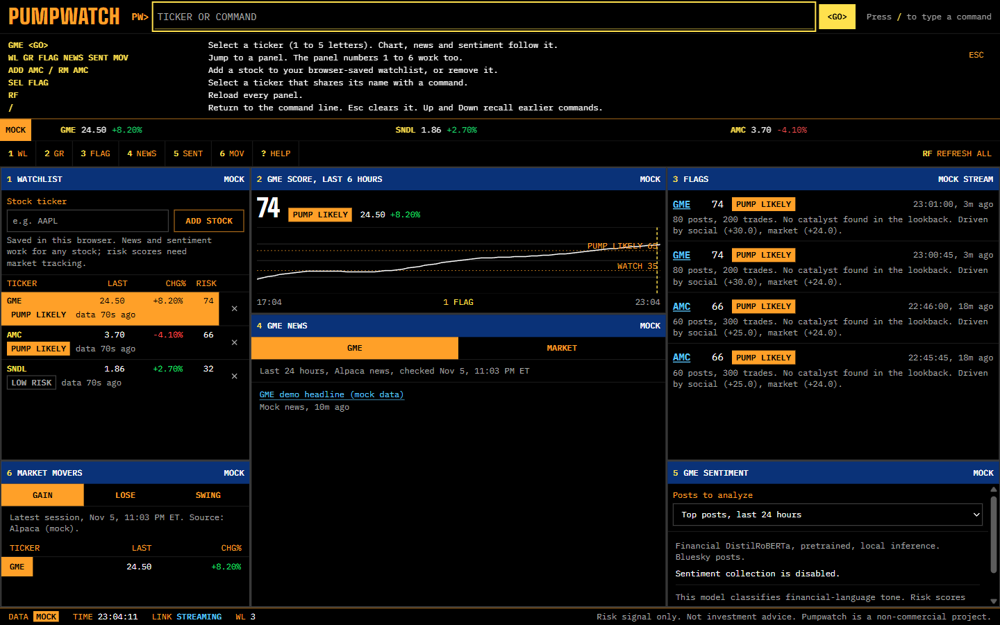

`HELP` lists the commands: a ticker selects it, `WL GR FLAG NEWS SENT MOV` or a panel number jumps to a panel, `ADD` and `RM` edit the watchlist.

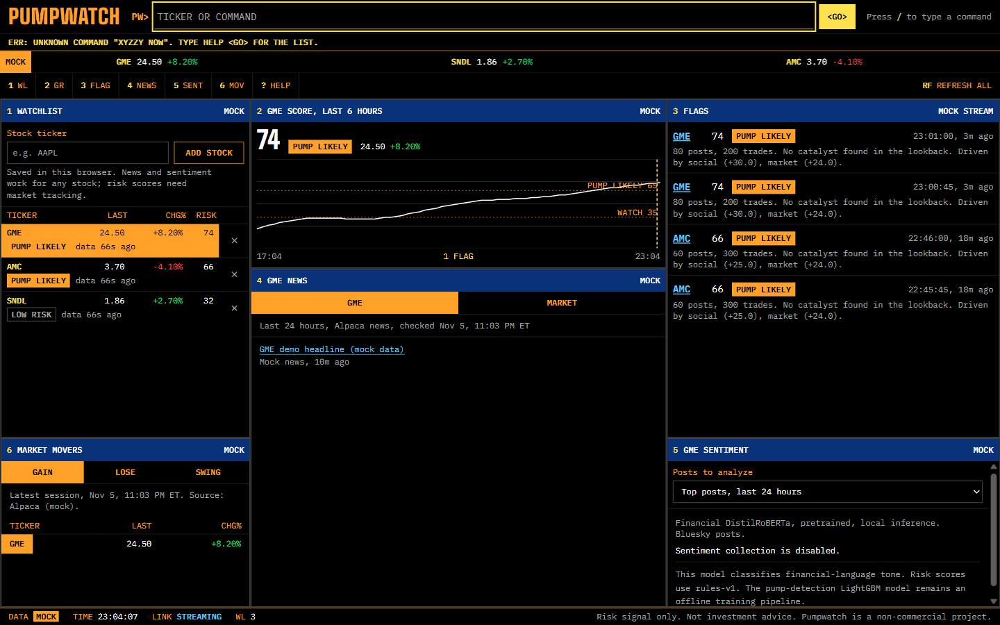

Unknown input shows an inline error and points to `HELP`.

### Mobile (390x844)

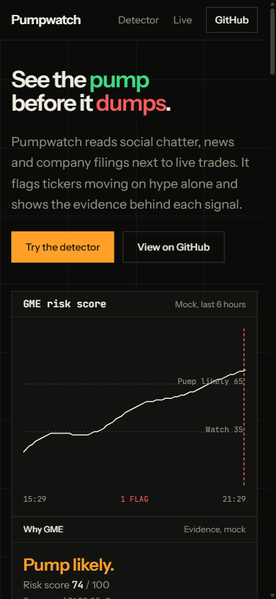

Landing hero on mobile.

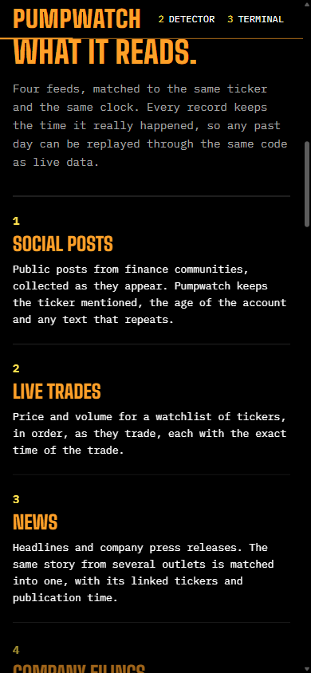

The numbered feeds list stacks to one column.

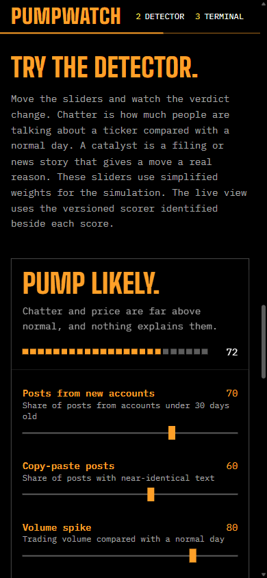

The detector keeps its verdict pinned above the sliders.

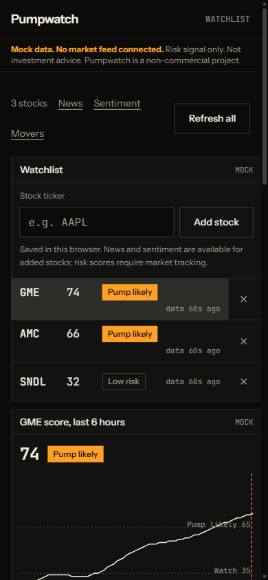

The terminal becomes one stacked column and keeps the command line, the ticker strip and the panel keys.

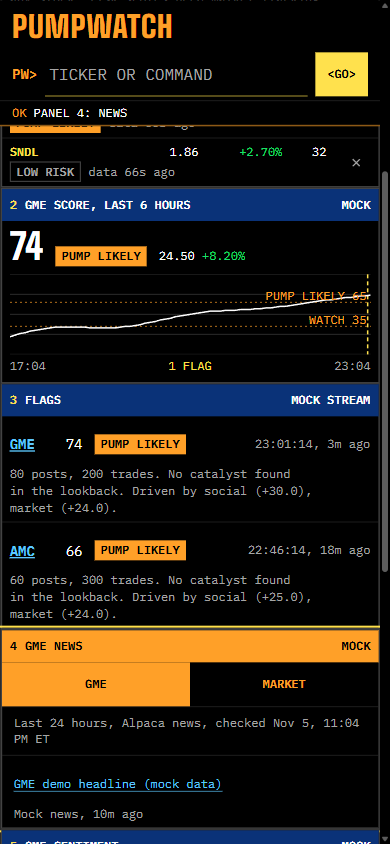

After `NEWS`: the news panel is highlighted below the score chart and flags.

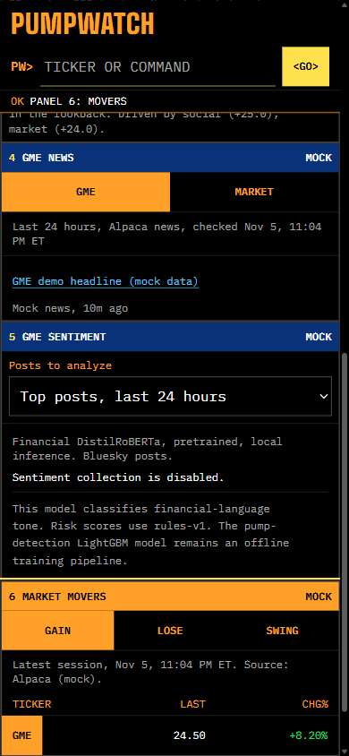

After `MOV`: the movers panel is highlighted at the end of the column.


## Documentation

| Guide | What it explains |
| --- | --- |
| [Tech stack](docs/tech-stack.md) | Technologies, versions, responsibilities and repository layout |
| [Architecture](docs/architecture.md) | Service diagrams, event flow, APIs, storage and configuration |
| [Research assistant spec](openspec/changes/add-research-assistant/design.md) | How Plutus is wired in, limits and the data policy |
| [Web setup](web/README.md) | Mock/live modes, personal watchlists and frontend checks |
| [Live sentiment](ml/LIVE-SENTIMENT.md) | Pretrained model, matching rules, retention and limits |
| [Risk scorer](docs/rule-scorer.md) | Thresholds, catalyst deductions and feature contributions |
| [Offline ML](ml/README.md) | Python training, evaluation and synthetic-data commands |
| [Source register](docs/data-sources.md) | Source permissions and verification status |
| [Roadmap](docs/roadmap.md) | Planned milestones; implementation checklists live in `openspec/changes/` |

## Research assistant (Plutus)

`plutus/` is the owner's [Plutus](https://github.com/RLinV1/Plutus) project, imported with its git history: an MCP tool server, RAG over plain-English company notes, a Claude agent with a zero-key mock agent, and an eval harness. In this repo it runs as a private `plutus` compose service (apps profile, no published port, healthchecked) and is wired to Pumpwatch both ways.

- **Pumpwatch to the assistant.** The Plutus tool `get_pump_risk` reads Pumpwatch's own read API (latest score, verdict, top contributors, recent flags, catalyst check), so "is GME being pumped?" is answered from the same evidence as the panels, and says whether it is mock or live.
- **Terminal to the assistant.** `ASK <question>` on `/live` fills panel 7 with the answer, the tools used and the cited sources, with loading, error and empty states. `ASK` alone jumps to the panel.
- **One origin.** The browser only calls `POST /api/v1/assistant/ask` on the web server, which checks the question (300 characters, 2 KB body, JSON only), rate limits it (5 per minute per client, 30 overall) and forwards it to the private service. Caddy is unchanged and the flag stream still bypasses Node.
- **Not investment advice.** Every answer carries the notice. Paper trading in Plutus is simulated only; nothing here places an order or talks to a broker.
- **Public data policy.** `deploy/up.sh` strips `ANTHROPIC_API_KEY` from the `.env` it copies and runs the assistant on mock data with the mock agent, so a visitor cannot spend your Claude credits or see real market data. On your own machine put `ANTHROPIC_API_KEY` in `.env` for real Claude (`claude-sonnet-5-5`) and set `PLUTUS_USE_MOCK_DATA=0` for live yfinance data.

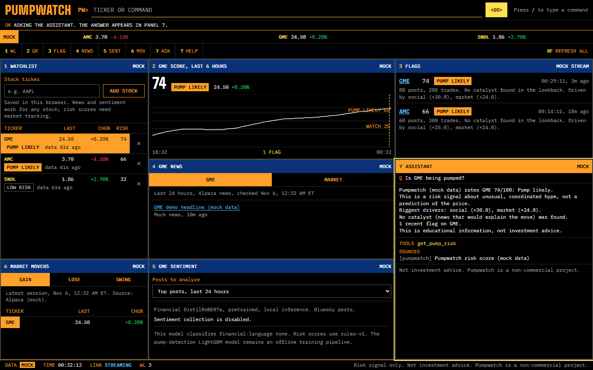

Mock mode: `ASK Is GME being pumped?` answered by the mock agent from the mock Pumpwatch API.

Run it locally with the `apps` profile (`docker compose --profile apps up -d --build`, which builds a large image because of torch), or without Docker: `cd plutus`, `pip install -e ".[dev]"` on Python 3.13 or older, `uvicorn api.assistant_service:app --port 8090`, then start the web server with `PLUTUS_ORIGIN=http://127.0.0.1:8090` and the service with `PUMPWATCH_API_URL=http://127.0.0.1:3000`.

**Not reachable from the terminal.** The Plutus React frontend is kept in `plutus/frontend/` but is not built or served, and the service exposes no portfolio tools. So these Plutus features are unavailable here until you decide otherwise:

| Plutus feature | Where it lives |
| --- | --- |
| Portfolio holdings, P&L, risk report, CSV import, equity curve | `api/portfolio_routes.py`, PortfolioView |
| Scenario stress tests and trade simulation, rebalance plans | ScenarioView, `portfolio/scenarios.py` |
| Paper trading and the leaderboard (simulated only) | PaperView, LeaderboardView |
| Price alerts and notifications | AlertsView |
| Market overview, ticker research pages, charts, price search | MarketView, ResearchView |
| Streaming chat widget and full Ask page | ChatWidget, AskView |
| Sign-in (Clerk), daily prompt quotas and Stripe billing | `api/auth.py`, `api/billing_routes.py` |
| Plutus's Elastic Beanstalk deploy scripts and workflows | `plutus/scripts/eb-*.sh`, `plutus/.github/workflows` (GitHub ignores them there) |

The market-data and RAG tools (snapshot, performance, technicals, news, filing risks, fundamentals and so on) are reachable, but only through `ASK`.

## How it works

1. **Ingest.** Connectors publish normalized records to Kafka topics:
   - `raw-posts`: Bluesky posts from the enabled Java connector; Reddit ingestion remains planned
   - `ticks`: Alpaca trade ticks (quotes are out of scope for now), keyed by ticker
   - `raw-news`: Alpaca News, Finnhub and press-release RSS
   - `raw-filings`: SEC EDGAR 8-K filings
   - `ingest-dlq`: records that failed validation
   - `source-health`: each connector's health every 15 s, used to mark stale sources on scores
2. **Record and replay.** Supported input and derived topics are recorded with their
   event times. Replay republishes recorded inputs at original or accelerated speed,
   either to base topics or isolated run topics. Isolated topics do not automatically
   provision another processing topology; see [replay boundaries](docs/architecture.md#recording-and-replay).
3. **Score.** An event-time pipeline combines social, market and catalyst
   features with a versioned rules scorer. Learned models remain behind their
   training, serving and promotion gates.
4. **Read and alert.** A read-only API exposes scores, timelines and flags;
   optional webhooks deliver alerts. The web app labels mock, live and simulated data.
5. **Add context.** The Node web host separately reads Alpaca news and market movers
   and runs a pretrained Financial DistilRoBERTa model on matching Bluesky posts.
   The default sample searches top posts from the last 24 hours; users can choose
   most recent posts or the live stream. Positive, neutral and negative counts
   appear beside the selected stock, with the sample size and time window.

The Java risk score and the web sentiment model are separate outputs. Enabling
sentiment does not enable Java social features or change the risk score.

Users can select stocks from gainers, losers or intraday swings, and add/remove up to
30 symbols in a browser-saved personal watchlist. Added stocks open news and sentiment;
they show **No risk score yet** if the backend has no coverage. Personal edits do not
change the shared market-data subscription.

## Stack

| Layer | Technologies |
| --- | --- |
| Dashboard | Next.js 16.4.2, React 19.3.0, TypeScript, Tailwind CSS 4 |
| Web host and sentiment | Node.js, Transformers.js 4.3.2, quantized ONNX model on CPU |
| Backend | Java 21, Spring Boot 3.5.5, Spring Kafka, Maven |
| Events and persistence | Apache Kafka 3.9.1, Kafka Streams, PostgreSQL 17, JDBC, Flyway |
| Offline research | Python, LightGBM, scikit-learn, pandas, NumPy |
| Infrastructure and checks | Docker Compose, GitHub Actions, JUnit, Testcontainers, Node test runner, pytest |

Versions come from repository manifests and Compose. See [tech stack](docs/tech-stack.md)
for each tool's role. Cloud deployment remains planned.

## Project status

Alpaca/Bluesky/news/filings ingestion, recording/replay, rules scoring, the read API,
webhooks and the web dashboard are implemented. Source enablement and usage permissions
are separate from adapter availability. The web app runs without keys in mock mode.
Reddit ingestion, a curated labeled dataset, learned pump-model serving, learned
volatility surfaces and the cloud proof remain incomplete. The Python training
workflow exists; synthetic training does not establish predictive performance.

This documentation describes the current checkout, including work submitted in open
PRs. The [OpenSpec](https://github.com/Fission-AI/OpenSpec) plans live in `openspec/changes/`:

| Change | Scope |
| --- | --- |
| `add-ingestion-pipeline` | Reddit and Alpaca connectors, Kafka topics, dead-letter handling, record and replay |
| `add-news-ingestion` | Alpaca News, SEC EDGAR 8-K, Finnhub and press-release RSS |

## Workflow

Use a descriptive feature branch; Codex-created branches use `codex/`. Commits use
Conventional Commit messages, and changes reach `main` through a pull request.

## Run locally

For the web app: Node 22.13+. For the backend: Docker with Compose v2, JDK 21 or newer
and Maven 3.9+. Offline research uses Python 3.11+; CI uses Python 3.12.

```bash
[ -f .env ] || cp .env.example .env # preserve an existing local configuration
(cd web && npm ci && npm run dev) # DATA_MODE=mock: no backend or keys needed

# Backend development and live-mode prerequisites:
scripts/dev-up.sh         # infra only: Kafka (KRaft), Postgres, topics
scripts/dev-up.sh --apps  # infra plus connectors, replay, pipeline and API
mvn -B verify             # build and test the Java modules
scripts/dev-down.sh       # stops everything; add --wipe to also delete volumes
```

On Windows, the mock dashboard can be started from PowerShell:

```powershell
if (-not (Test-Path .env)) { Copy-Item .env.example .env }
Set-Location web
npm ci
npm run dev
```

Open [localhost:3000/live](http://localhost:3000/live). New setups default to
`DATA_MODE=mock`; existing `.env` files keep their current mode. To use port 3100,
set `$env:PORT='3100'` before starting the web server.

For live mode, privately fill in the Alpaca keys in root `.env`, set
`DATA_MODE=live` and `ALPACA_ENABLED=true`, then start the backend. A shell-independent
alternative to the Bash helper is:

```sh
docker compose --profile apps up -d --build --wait
```

Compose runs the Java services, Kafka and PostgreSQL; start the web host separately
with npm. Set `SENTIMENT_ENABLED=true` for the independent web sentiment service.
`BLUESKY_ENABLED` separately controls Java social ingestion. Restart the web server
after configuration changes; rebuild production web output after changing `API_ORIGIN`.

Scores may lag while connectors backfill a gap; inspect their data age. Sentiment
searches can classify recent posts immediately. The optional live-stream sample
collects posts after startup/selection and clears on restart. A zero count means no
matching posts in that sample, not an absence of all discussion about the stock.

With `--apps`, health is at http://localhost:8080/actuator/health (connectors)
and http://localhost:8081/actuator/health (replay), 8082 (pipeline), and 8083 (API).
The containers read `.env` and use Kafka and Postgres inside the Compose network.
See [web setup](web/README.md) for `DATA_MODE=live`, private API proxy configuration,
source enablement and the distinction between mock data and real-feed validation.

To run the apps from the IDE instead, use `scripts/dev-up.sh` (infra only) and
export `.env` first, because Spring Boot does not read it:
`set -a; source .env; set +a`. Then start the `connectors` and `replay` main
classes; they reach Kafka on 127.0.0.1:9092 and Postgres on 127.0.0.1:5432.

## Deploy and load test

One Google Cloud VM runs the whole stack behind a Caddy proxy, with one public port.
Terraform, deploy scripts and the runbook are in [docs/deploy-gcp.md](docs/deploy-gcp.md).

Load tests live in `load/`: a ramping [k6](https://k6.io) read-API test, and a live-stream test
with real SSE clients that counts a client only if data actually reaches it.

```bash
BASE=http://<host> VUS=100 CONNS=1000 load/run.sh   # writes load/results/summary.md
```

Local baseline, 2026-11-05. Full compose stack (Caddy, Next.js, Spring Boot, Postgres, Kafka) on
Docker Desktop for Windows, with the load generator on the same 16-core machine. Seeded with 50
tickers, 18,000 score rows and 200 flags (`load/seed.sql`), rate limit raised. Not a cloud result.

| Test | Result |
| --- | --- |
| Read API, 100 virtual users, 90 s | 39,504 requests, 438.8 req/s, 0.00% errors |
| Read API latency | p50 174 ms, p95 397 ms, p99 1,024 ms |
| Live stream | 1,000 of 1,000 clients receiving data, 0 dropped, 0 refused |
| Flag delivery to 1,000 clients | all delivered, p95 between 0.9 s and 1.7 s over 4 runs (API polls once a second) |
| Default limits, 80 parallel requests | 46 rejected with 429; a forged `X-Forwarded-For` did not help; a second client stayed at 200 |

Limit tests, 2026-11-06, same machine. `load/kafka.sh` and `load/pipeline.sh` use throwaway topics and a throwaway stack.

| Test | Result |
| --- | --- |
| Live clients | 7,999 of 8,000 received a flag, p95 4.9 s. Hard stop at about 8,190 (Tomcat `max-connections`). Above the cap, the API ran out of its default heap (about 1.4 GB). |
| Kafka produce, one broker, 256-byte records, `acks=all` | 399,000 msg/s (97 MB/s) at p95 3 ms. Peak 470,000 msg/s; p99 spikes at higher offered rates |
| Kafka consume | 1.02 million msg/s |
| Scoring pipeline, backlog of 300,000 ticks replaying one hour, 50 tickers | 164,508 ticks processed in about 2 minutes, up from 3,507 before folding ticks into 15 second panes (about 47x). Worst case: event time runs far faster than real time |

`api.max-streams` defaults to 100 as a safety limit. Raise it with `API_MAX_STREAMS`, and keep it under the limits above.

## Development checks

Run `mvn -B verify` from the root. In `web/`, run `npm test`, `npm run lint` and
`npm run build`. In `ml/`, install `requirements-dev.txt` and run `python -m pytest`.
Docker is needed for Testcontainers integration tests; web tests open local HTTP/SSE
listeners. GitHub Actions also runs dependency-license checks. See the
[build and test tools](docs/tech-stack.md#checks-and-build-tools) for details.
