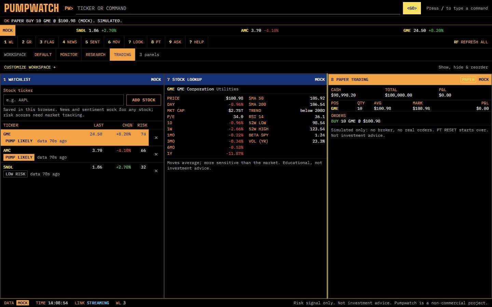
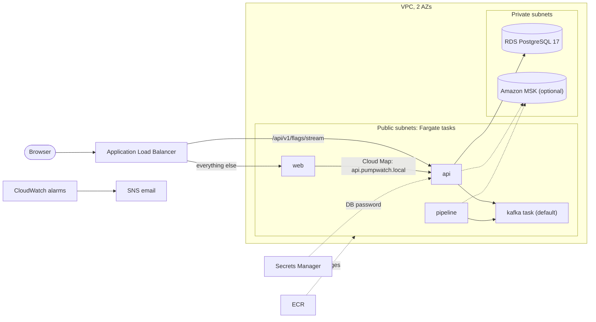

# PumpDump (Pumpwatch)

Real-time detection of coordinated pump-and-dump activity for retail investors.
Pumpwatch watches social chatter, news, SEC filings and market data together,
and flags tickers where hype is rising without a real catalyst behind it.

The dashboard brings together risk scores, stock news, gainers/losers, observed intraday
swings and pretrained Bluesky sentiment. The output is a risk signal with its evidence,
not buy or sell advice. Sentiment describes sampled text; it does not predict returns.

## App walkthrough

The screenshots below come from the current production UI with labelled **MOCK** data.
Stock figures and orders are synthetic. The assistant uses its rule-based mock agent.
Live Bluesky collection is deliberately off in these screenshots; live mode uses the
local FinTwitBERT model and a separate possible-irony check rather than invented sentiment counts.

### Your workspace

Choose a starting layout, then open **Customize workspace** to show or hide panels
and move them up or down. Changes save in this browser, including across reloads.
**Restore default** brings back the standard layout. Commands automatically reveal
a hidden panel, so every feature remains reachable.

| Layout | Panels |
| --- | --- |
| Default | Watchlist, risk chart, flags, movers, news and sentiment |
| Monitor | Watchlist, risk chart and flags |
| Research | Stock lookup, assistant, news and sentiment |
| Trading | Watchlist, stock lookup and paper trading |
| Custom | Your chosen panels in your chosen order |


### Pump-and-dump watch

The watchlist ranks tracked stocks by risk. Selecting a ticker updates the six-hour
score chart, news and sentiment. Flags show the triggering evidence, contributing
feature groups and whether a catalyst was found. The risk score uses rules-v1;
sentiment is separate context.


### Stock search and personal watchlist

Type a ticker to select it, use **Add stock** or `ADD AAPL` to save it in this browser,
and use `LOOK GME` or `DES GME` for the stock snapshot. Untracked stocks show
**No risk score yet**. Lookup includes performance, moving averages, RSI, beta,
volatility and the 52-week range.


### Research: news, sentiment and market movers

The Default layout includes stock/market news and gainers, losers and intraday
swings. Select any mover to inspect it. The Research layout pairs stock lookup with
ASK, news and the sentiment panel. Sentiment offers top posts or recent posts from
the last 24 hours, plus the live Bluesky stream. It analyzes Bluesky posts, not
X/Twitter tweets. Mock mode reports that collection is off; live mode reports the
actual classified sample and model status.


### Paper trading

`BUY GME 10` and `SELL GME 5` create simulated orders at server-decided prices.
The Trading layout shows cash, positions, marks, P&L and recent orders alongside
stock lookup. `PT RESET` requires a second confirmation. No real orders are sent.



### Assistant, MCP tools and the knowledge library

`ASK Is GME being pumped?` reads the same risk signals as the dashboard.
`ASK What is a pump and dump?` retrieves the local Chroma knowledge library.
Answers identify Gemini or the mock agent, data mode, tools and sources.
The assistant's MCP tools can read data and your paper account; they cannot trade.


### Keyboard commands and mobile

Type `HELP` to see the commands. `/` focuses the command line; the arrow keys recall
commands and Escape clears it. Workspace selection and customization also work on
phones, where panels stack in the saved order.


### Landing page and simulated detector

The landing page explains the inputs and scoring flow. Its interactive detector
lets readers compare coordinated hype with a move supported by a news catalyst.
The detector is a labelled simulation, separate from market analysis.

### Model checks and load tests

See [the model comparison and retained failures](docs/sentiment-evaluation-2026-11-06.md)
and [the local performance/optimization report](docs/performance-2026-11-06.md).
Use `SENTIMENT_ENABLED=true` in live mode for FinTwitBERT plus a separate possible-irony
count; use `NEWS_SENTIMENT_ENABLED=true` for Financial DistilRoBERTa headline tone.
The 46 synthetic social examples exposed sarcasm and negation errors. Neither model
is claimed to perfectly interpret posts, and possible irony never reverses tone labels.


## Documentation

| Guide | What it explains |
| --- | --- |
| [Tech stack](docs/tech-stack.md) | Technologies, versions, responsibilities and repository layout |
| [Architecture](docs/architecture.md) | Service diagrams, event flow, APIs, storage and configuration |
| [Lookup and paper trading spec](openspec/changes/add-paper-trading-lookup/design.md) | How Plutus is wired in, limits and the data policy |
| [Web setup](web/README.md) | Mock/live modes, personal watchlists and frontend checks |
| [Live sentiment](ml/LIVE-SENTIMENT.md) | Pretrained model, matching rules, retention and limits |
| [Risk scorer](docs/rule-scorer.md) | Thresholds, catalyst deductions and feature contributions |
| [Offline ML](ml/README.md) | Python training, evaluation and synthetic-data commands |
| [Source register](docs/data-sources.md) | Source permissions and verification status |
| [Roadmap](docs/roadmap.md) | Planned milestones; implementation checklists live in `openspec/changes/` |

## Stock lookup and paper trading (Plutus)

The pump watch is the product. `plutus/` is the owner's [Plutus](https://github.com/RLinV1/Plutus) project, imported with its git history. Stock lookup, paper trading and a read-only research assistant sit beside the pump panels in the `/live` terminal.

- **Stock lookup.** `LOOK GME` (alias `DES GME`) fills panel 7 with the name, sector, price, daily move, market cap and P/E, price performance, SMAs, RSI, 52-week range, beta and volatility, from the pure numpy/pandas code in `plutus/src/portfolio_risk/risk/`.
- **Paper trading.** `BUY GME 10`, `SELL GME 10`, `PT` and `PT RESET` (then `PT RESET CONFIRM`) drive panel 8, marked PAPER: cash, positions, P&L and order history. Whole shares, no shorting, integer cents, atomic updates.
- **Anonymous.** No sign-in. Your browser makes a random account token, keeps it in localStorage and sends it in a header; the service stores only its hash, in SQLite on the `plutuspaper` volume. Clear your browser data and the account is gone.
- **Server-decided prices.** The browser never sends a price. Mock mode fills at the service's mock close. Live mode (your own machine only) fills at the web server's own Alpaca quote, and the order is refused if there is none. Lookups in live mode use yfinance.
- **One origin.** The browser only calls `/api/v1/lookup` and `/api/v1/paper` on the web server, which validates, rate limits and forwards to the private `plutus` service (apps profile, no published port). Caddy is unchanged and the flag stream still bypasses Node.
- **Public data policy.** `deploy/up.sh` keeps the VM on mock data, so every public figure is labelled MOCK. Real data stays on your machine: set `DATA_MODE=live` with Alpaca keys, and `PLUTUS_USE_MOCK_DATA=0` for yfinance lookups.

> **This is simulated trading, not advice.** There is no broker, no real order and no real money, and nothing here is investment advice. Pumpwatch is a non-commercial project.


Mock mode, 1440x900. Mock prices do not move, so a mock buy then sell returns the same cash with zero P&L.

Run it locally with the `apps` profile (`docker compose --profile apps up -d --build`), or without Docker: `cd plutus`, `pip install -e ".[dev]"` on Python 3.13, `USE_MOCK_DATA=1 uvicorn api.service:app --port 8090`, then start the web server with `PLUTUS_ORIGIN=http://127.0.0.1:8090`. CI lints all of `plutus/` with ruff and runs its tests on Python 3.13.

## Research assistant (Gemini, MCP and RAG)

Type `ASK Is GME being pumped?`, or open panel 9 with `ASK`, `AI` or `9`.
Answers identify the answering agent (Gemini or the rule-based mock), data mode,
tools used and retrieved sources. The assistant can read stock snapshots, price
performance, technical indicators, news, pump signals, sentiment and your own paper
account. Its MCP tools are read-only: it cannot place orders.

Docker Compose starts the private Plutus service and connects its tools to the web
host. Without a key it uses the mock agent. For local Gemini use, add your own
`GEMINI_API_KEY` to the root `.env`; `USE_MOCK_LLM=auto` selects Gemini when the key
is present. `GEMINI_MODEL` defaults to `gemini-3.6-flash` and can be overridden.
Set `USE_MOCK_LLM=1` to force mock answers. Restart the service after configuration
changes. Gemini failures fall back to the mock agent with an explanatory note.
Public VM deployments remove Gemini settings and force the mock agent; AWS also
uses mock data and the mock agent without a key.

The Chroma library embeds the bundled Markdown seed documents with local ONNX
all-MiniLM-L6-v2. Docker builds both this library and the pinned Financial
DistilRoBERTa sentiment model ahead of time; the first build downloads their public
weights. Social posts use FinTwitBERT plus CardiffNLP possible irony; optional news
headline tone uses Financial DistilRoBERTa. Sentiment stays separate from the rules risk score.

For a non-Docker setup on Python 3.13, install `plutus/` with `pip install -e ".[dev]"`,
then run these commands from that directory:

```bash
python -m portfolio_risk.rag.ingest
python -m evals.run_evals --agent mock
USE_MOCK_DATA=1 USE_MOCK_LLM=1 PUMPWATCH_API_URL=http://127.0.0.1:3000 uvicorn api.service:app --port 8090
```

Start the web host with `PLUTUS_ORIGIN=http://127.0.0.1:8090`. The evaluation gate
checks tool selection, numeric accuracy, groundedness and retrieval against checked-in
thresholds. CI builds the seed library and runs this gate with the mock agent; it
does not need Gemini credentials.

## How it works

1. **Ingest.** Connectors publish normalized records to Kafka topics:
   - `raw-posts`: Bluesky posts from the enabled Java connector; Reddit ingestion remains planned
   - `ticks`: Alpaca trade ticks (quotes are out of scope for now), keyed by ticker
   - `raw-news`: Alpaca News, Finnhub and press-release RSS
   - `raw-filings`: SEC EDGAR 8-K filings
   - `ingest-dlq`: records that failed validation
   - `source-health`: each connector's health every 15 s, used to mark stale sources on scores
2. **Record and replay.** Supported input and derived topics are recorded with their
   event times. Replay republishes recorded inputs at original or accelerated speed,
   either to base topics or isolated run topics. Isolated topics do not automatically
   provision another processing topology; see [replay boundaries](docs/architecture.md#recording-and-replay).
3. **Score.** An event-time pipeline combines social, market and catalyst
   features with a versioned rules scorer. Learned models remain behind their
   training, serving and promotion gates.
4. **Read and alert.** A read-only API exposes scores, timelines and flags;
   optional webhooks deliver alerts. The web app labels mock, live and simulated data.
5. **Add context.** The Node web host separately reads Alpaca news and market movers
   and runs FinTwitBERT on matching Bluesky posts, with CardiffNLP possible irony
   reported separately. Financial DistilRoBERTa supplies optional news-headline tone.
   The default sample searches top posts from the last 24 hours; users can choose
   most recent posts or the live stream. Positive, neutral and negative counts
   appear beside the selected stock, with the sample size and time window.

The Java risk score and the web sentiment model are separate outputs. Enabling
sentiment does not enable Java social features or change the risk score.

Users can select stocks from gainers, losers or intraday swings, and add/remove up to
30 symbols in a browser-saved personal watchlist. Added stocks open news and sentiment;
they show **No risk score yet** if the backend has no coverage. Personal edits do not
change the shared market-data subscription.

## Stack

| Layer | Technologies |
| --- | --- |
| Dashboard | Next.js 16.4.2, React 19.3.0, TypeScript, Tailwind CSS 4 |
| Web host and sentiment | Node.js, Transformers.js 4.3.2, quantized ONNX model on CPU |
| Backend | Java 21, Spring Boot 3.5.5, Spring Kafka, Maven |
| Events and persistence | Apache Kafka 3.9.1, Kafka Streams, PostgreSQL 17, JDBC, Flyway |
| Offline research | Python, LightGBM, scikit-learn, pandas, NumPy |
| Infrastructure and checks | Docker Compose, GitHub Actions, JUnit, Testcontainers, Node test runner, pytest |

Versions come from repository manifests and Compose. See [tech stack](docs/tech-stack.md)
for each tool's role. Cloud deployment remains planned.

## Project status

Alpaca/Bluesky/news/filings ingestion, recording/replay, rules scoring, the read API,
webhooks and the web dashboard are implemented. Source enablement and usage permissions
are separate from adapter availability. The web app runs without keys in mock mode.
Reddit ingestion, a curated labeled dataset, learned pump-model serving, learned
volatility surfaces and the cloud proof remain incomplete. The Python training
workflow exists; synthetic training does not establish predictive performance.

This documentation describes the current checkout, including work submitted in open
PRs. The [OpenSpec](https://github.com/Fission-AI/OpenSpec) plans live in `openspec/changes/`:

| Change | Scope |
| --- | --- |
| `add-ingestion-pipeline` | Reddit and Alpaca connectors, Kafka topics, dead-letter handling, record and replay |
| `add-news-ingestion` | Alpaca News, SEC EDGAR 8-K, Finnhub and press-release RSS |

## Workflow

Use a descriptive feature branch; Codex-created branches use `codex/`. Commits use
Conventional Commit messages, and changes reach `main` through a pull request.

## Run locally

For the web app: Node 22.13+. For the backend: Docker with Compose v2, JDK 21 or newer
and Maven 3.9+. Offline research uses Python 3.12+; CI uses Python 3.12.

```bash
[ -f .env ] || cp .env.example .env # preserve an existing local configuration
(cd web && npm ci && npm run dev) # DATA_MODE=mock: no backend or keys needed

# Backend development and live-mode prerequisites:
scripts/dev-up.sh         # infra only: Kafka (KRaft), Postgres, topics
scripts/dev-up.sh --apps  # infra plus connectors, replay, pipeline and API
mvn -B verify             # build and test the Java modules
scripts/dev-down.sh       # stops everything; add --wipe to also delete volumes
```

On Windows, the mock dashboard can be started from PowerShell:

```powershell
if (-not (Test-Path .env)) { Copy-Item .env.example .env }
Set-Location web
npm ci
npm run dev
```

Open [localhost:3000/live](http://localhost:3000/live). New setups default to
`DATA_MODE=mock`; existing `.env` files keep their current mode. To use port 3100,
set `$env:PORT='3100'` before starting the web server.

For live mode, privately fill in the Alpaca keys in root `.env`, set
`DATA_MODE=live` and `ALPACA_ENABLED=true`, then start the backend. A shell-independent
alternative to the Bash helper is:

```sh
docker compose --profile apps up -d --build --wait
```

Compose runs the Java services, Kafka and PostgreSQL; start the web host separately
with npm. Set `SENTIMENT_ENABLED=true` for the independent web sentiment service.
`BLUESKY_ENABLED` separately controls Java social ingestion. Restart the web server
after configuration changes; rebuild production web output after changing `API_ORIGIN`.

Scores may lag while connectors backfill a gap; inspect their data age. Sentiment
searches can classify recent posts immediately. The optional live-stream sample
collects posts after startup/selection and clears on restart. A zero count means no
matching posts in that sample, not an absence of all discussion about the stock.

With `--apps`, health is at http://localhost:8080/actuator/health (connectors)
and http://localhost:8081/actuator/health (replay), 8082 (pipeline), and 8083 (API).
The containers read `.env` and use Kafka and Postgres inside the Compose network.
See [web setup](web/README.md) for `DATA_MODE=live`, private API proxy configuration,
source enablement and the distinction between mock data and real-feed validation.

To run the apps from the IDE instead, use `scripts/dev-up.sh` (infra only) and
export `.env` first, because Spring Boot does not read it:
`set -a; source .env; set +a`. Then start the `connectors` and `replay` main
classes; they reach Kafka on 127.0.0.1:9092 and Postgres on 127.0.0.1:5432.

## Deploy and load test

One Google Cloud VM runs the whole stack behind a Caddy proxy, with one public port.
Terraform, deploy scripts and the runbook are in [docs/deploy-gcp.md](docs/deploy-gcp.md).

### AWS (Terraform, not deployed by CI)

`infra/aws/` describes the same stack on AWS: ECS Fargate services behind an Application Load Balancer, RDS PostgreSQL 17,
ECR, Cloud Map, Secrets Manager, CloudWatch and a Budgets alarm, with Kafka either as one Fargate task (default, data lost
on restart) or Amazon MSK (`enable_msk`). It runs mock data only. Nothing is deployed until you run `deploy/aws-up.sh`; it
bills hourly, so destroy it with `deploy/aws-down.sh`. Runbook and cost estimates: [docs/deploy-aws.md](docs/deploy-aws.md).



Load tests live in `load/`: a ramping [k6](https://k6.io) read-API test, and a live-stream test
with real SSE clients that counts a client only if data actually reaches it.

```bash
BASE=http://<host> VUS=100 CONNS=1000 load/run.sh   # writes load/results/summary.md
```

Fresh local results (November 6, 2026): 612.6 direct-API requests/s at 100 virtual
users, successful-response p95 322.2ms, and 1,000/1,000 clients receiving a synthetic
flag through the proxy at p95 1.755s. The API run had 29 throttled responses and no
other errors. Capacity runs temporarily raised limits; normal limits were restored.

See [the performance and optimization report](docs/performance-2026-11-06.md) for
hardware, raw results, commands, test conditions, the existing 15-second pane
optimization and its latency/late-data tradeoffs. Earlier stress numbers are clearly
separated from freshly verified results. These are local measurements, not cloud
capacity or proof of a before/after speedup.

## Development checks

Run `mvn -B verify` from the root. In `web/`, run `npm test`, `npm run lint` and
`npm run build`. In `ml/`, install `requirements-dev.txt` and run `python -m pytest`.
Docker is needed for Testcontainers integration tests; web tests open local HTTP/SSE
listeners. GitHub Actions also runs dependency-license checks. See the
[build and test tools](docs/tech-stack.md#checks-and-build-tools) for details.
