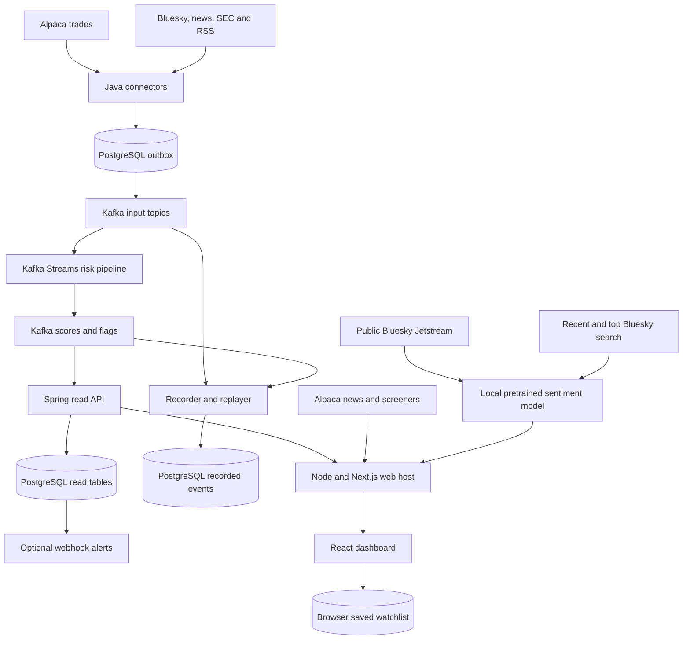
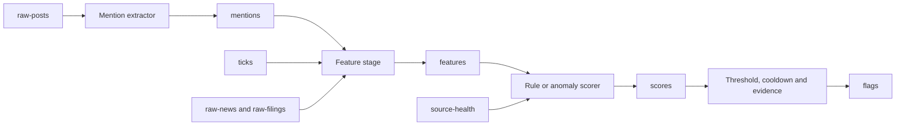

# Architecture and data flow

Pumpwatch has a durable Java risk-processing path and a separate web context path.
They meet in the dashboard, but use different state and produce different signals.
This describes the current checkout, including work submitted in open PRs.

## System overview

Source arrows represent implemented adapters, not sources enabled by default.
The browser sends same-origin requests to Node: live risk requests are proxied to
Spring, while live context requests are answered by Node itself.

## Services and state

| Component | Default port | Responsibility and state |
| --- | --- | --- |
| Web host | 3000 | Next.js, risk proxy, cached provider reads and in-memory sentiment |
| Connectors | 8080 | Source fetching, durable positions/deduplication and pending Kafka deliveries |
| Recorder/replayer | 8081 | Persist supported records and republish input events at a chosen speed |
| Pipeline | 8082 | Streams topology and state stores for features, scores and flagging |
| Risk API | 8083 | PostgreSQL read models, REST/SSE and scheduled webhook alerts |
| Kafka | 9092 from host; 19092 in Compose | Source/intermediate/result streams and Streams internal topics |
| PostgreSQL | 5432 | Connector state, recordings, API read tables and alert outboxes |

Java services share a database with distinct Flyway history tables. Their
`baseline-version: 0` settings let each service run its V1 migration after another
service has created tables. Compose mounts named Kafka/PostgreSQL volumes; stopping
containers preserves them unless the volumes are explicitly deleted.

## Risk path: provider to dashboard

### Ingest and publish

Alpaca authenticates, subscribes to the shared `WATCHLIST`, and can backfill a gap
through historical trade reads. Other implemented Java adapters cover Bluesky,
Alpaca News, Finnhub, SEC EDGAR and press-release RSS. Each needs separate enablement
and configuration. Reddit placeholders exist, but its connector is not implemented.

`common/` defines versioned JSON contracts, ticker keys and validation. Records
distinguish provider `eventTime` from local `ingestTime`. Invalid connector records
go to `ingest-dlq`.

Accepted records enter a bounded PostgreSQL outbox. The publisher removes a row only
after Kafka acknowledgement. A full outbox applies backpressure rather than silently
discarding records. Resends across delivery attempts can still duplicate a record;
consumers need the relevant key/offset deduplication.

| Kafka topic | Contents | Main consumers |
| --- | --- | --- |
| `raw-posts` | Normalized social posts from enabled Java sources | Mention extractor, recorder |
| `ticks` | Trade records keyed by ticker | Feature stage, recorder |
| `raw-news` | Normalized news records | Feature stage, recorder |
| `raw-filings` | Normalized SEC filing records | Feature stage, recorder |
| `source-health` | Connector health every 15 seconds | Scorer |
| `ingest-dlq` | Invalid records and validation failures | Operational inspection |
| `mentions` | Ticker-linked social features | Feature stage |
| `features` | Per-ticker event-time windows | Scorer, recorder |
| `scores` | Versioned risk scores and stale-source markers | Flagger, API, recorder |
| `flags` | Threshold crossings and evidence | API, recorder; alerts read the API tables |

### Extract, aggregate, score and flag

Four stages run in one Kafka Streams application and communicate through topics:

The feature stage uses 1-, 5- and 30-minute event-time hopping windows, advancing
every 15 seconds with a two-minute grace period. The default scorer reads five-minute
features. Social features describe chatter/duplication, market features describe
returns/trading activity, and catalysts describe news/filings. Stream progress and
late arrivals affect when windows update.

`rules-v1` adds threshold points, subtracts points for explaining catalysts, and
clamps the result to 0–100. The default flag threshold is 60, with cooldown and
reflag settings controlling repeats. Evidence includes feature-group contributions
computed by rescoring with each group removed. [The scorer guide](rule-scorer.md)
defines the thresholds, anomaly alternative and source-staleness semantics.

Streams uses `exactly_once_v2` with a 15-second commit interval. This applies inside
Streams; it does not mean every external fetch or webhook happens exactly once.

### Store and serve results

The API's `Ingest` listener validates scores/flags and inserts into `api_scores` and
`api_flags`. Topic/partition/offset identities make repeated delivery idempotent
at this boundary. Latest-score queries order by the event window, not arrival time.

REST serves latest scores, timelines and recent flags. `SseHub` polls stored flags,
emits SSE events/heartbeats and supports `Last-Event-ID` resume. The browser also
refreshes REST history on stream connection/reconnection to recover gaps and retries
failed reads.

Optional alerts read live flags from the database. A durable alert outbox,
per-channel deduplication, ticker cooldown, burst digests and retry backoff govern
webhook delivery. Replay-run flags are excluded from alert planning.

## Web context path

These Node services can operate while the Java risk backend is unavailable:

| Feature | How it works |
| --- | --- |
| Stock news | Reads the last 24 hours of Alpaca News for a symbol; returns headline, source, time and safe HTTPS link |
| Daily news | Makes a separate market-wide news query |
| Gainers/losers | Validates and ranks Alpaca SIP screener results |
| Intraday swings | Screens configured symbols, movers and active stocks; ranks `(daily high - daily low) / previous close × 100` using the configured snapshot feed |
| Sentiment | Searches recent top/latest posts or filters Jetstream, then classifies matching text with local pretrained Financial DistilRoBERTa |

Intraday range is an observed volatility proxy over screened candidates, not a
learned forecast or exhaustive market-wide volatility ranking. Provider reads are
cached/coalesced and bounded by deadlines. Failures produce unavailable states instead
of synthetic live values. Context routes reject replay `runId`s.

### Sentiment lifecycle

The default panel sample searches top-ranked posts from the last 24 hours; users
can choose latest-ranked posts instead. Node checks up to 50 results, filters ticker
relevance/time bounds, removes duplicate post URIs and classifies at most 25 posts.
Only aggregates are cached for one minute. Search and streaming share one serial
model scheduler but maintain separate sample counts. Failures are unavailable states,
not zero sentiment. The live-stream option follows this lifecycle:

1. `SENTIMENT_ENABLED=true` in live mode loads the pinned quantized ONNX model and
   opens Jetstream. First startup may download the model into its ignored cache.
2. The server `WATCHLIST` is tracked. Reading another selected ticker also tracks
   it, up to 64 additional symbols. Extra selections expire after an hour without
   reads; at the limit, the least recently read one is evicted.
3. Matching requires a tracked cashtag such as `$AMC`, or an uppercase tracked symbol
   alongside financial language. Malformed, old or future-dated events are rejected.
4. One CPU inference runs at a time with a bounded queue and timeout, producing
   positive, neutral or negative labels.
5. A one-hour in-memory window counts labels per ticker. Hashed record identifiers
   support deduplication and deletion handling. Public responses contain counts/status,
   not text or author identifiers.

Raw text is transient in the web queue. Retained samples are bounded, expire, and
clear on web-server restart. The live window is not populated from search results,
persisted across restarts or used for retraining. A connected stream can have zero matching samples; zero does
not mean no discussion of that company exists elsewhere on Bluesky.

`BLUESKY_ENABLED` controls a different, Java connector that feeds social risk features.
It does not control this web model. Positive sentiment is not itself a pump flag,
and these counts do not alter Java risk scores. See [live sentiment](../ml/LIVE-SENTIMENT.md)
for the model's training domain, license and detailed limits.

## Browser behavior and personal watchlists

The landing shell paints before API loading. A complete snapshot replaces its
labeled simulation; unavailable, empty, invalid or timed-out snapshots preserve the
fallback. Public-response validation prevents mock/live values sharing a market panel.

The dashboard polls risk/context reads and listens for flags. Refresh failures retain
last good data with a message. Score age uses `windowEnd`: a newly computed score can
describe old data during backfill, so computation time is not its freshness label.

The initial watchlist comes from available API scores. The first edit saves that
list under `pumpwatch:watchlist` in browser `localStorage`. Users can add/remove up to
30 symbols; an intentionally empty saved list stays empty. Storage events update open
tabs. There are no user accounts or cross-device synchronization.

Selecting a saved stock or a mover updates news, sentiment and timeline panels.
Mover selection scrolls to sentiment. Added symbols without backend coverage show
**No risk score yet**. Personal edits do not update server `WATCHLIST`, subscribe
Alpaca symbols or enable new pipeline coverage. Clearing browser storage restores
the default list of available API scores.

## Recording and replay

The recorder stores `raw-posts`, `ticks`, `raw-news`, `raw-filings`, `features`,
`scores` and `flags`, preserving event times and Kafka identities. It skips replay-marked
records to avoid recording its own output.

`POST /replays` on port 8081 accepts `from`, `to`, `speed` and `isolated`, returns a
run ID, and publishes asynchronously. The replayer republishes inputs, skips recorded
derived results, preserves event times and scales delays between records.

- `isolated: true` publishes to `replay.<runId>.<original-topic>`.
- `isolated: false`, also the default when omitted, publishes to the original topics.
- Published records carry replay and run-ID headers.

The default Streams topology consumes base topic names. Creating isolated topics
does not automatically provision a separate processing pipeline for them; that needs
corresponding wiring. Replaying into base topics can affect shared live processing
state and is not equivalent to an isolated run.

The API stores results by run ID and defaults to live reads unless a replay run is
explicitly requested. That read isolation does not create separate Streams state.

## Public routes

Paths are relative to the web host unless specified. In live mode, risk reads go to
Spring and context reads stay in Node.

| Route | Owner | Result |
| --- | --- | --- |
| `GET /api/v1/watchlist` | Spring | Latest available risk scores, not personal browser preferences |
| `GET /api/v1/tickers/{ticker}/timeline` | Spring | Scores/flags for `from`/`to`; six hours by default, maximum 48 hours |
| `GET /api/v1/flags?limit=20` | Spring | Recent flags; maximum limit 100 |
| `GET /api/v1/flags/stream` | Spring | SSE flags/heartbeats; resumes via `Last-Event-ID` |
| `GET /api/v1/market-movers` | Node | Gainers, losers and screened ranges |
| `GET /api/v1/news` | Node | Daily headlines |
| `GET /api/v1/tickers/{ticker}/news` | Node | Selected-stock headlines |
| `GET /api/v1/tickers/{ticker}/sentiment` | Node | `sample=top/latest`: recent 24-hour search counts; omitted or `sample=stream`: one-hour live counts; also tracks the ticker |
| `POST /replays` on port 8081 | Replay | Starts an operator replay; not exposed by the web `/api` proxy |

Ticker routes accept 1–5 uppercase A–Z letters. Risk JSON envelopes contain `notice`
and `data`; context/mock responses also identify their mode. Web API responses carry
`X-Pumpwatch-Data-Mode`. Risk/context APIs are read-only; personal watchlist edits
operate in browser storage, while replay is a separate operator API.

## Configuration and data modes

The custom web host loads root `.env`. Compose uses it for interpolation and application
environment files. Direct Java/IDE runs need values explicitly exported. The blank
template is [`.env.example`](../.env.example); real credentials must remain untracked.

| Setting | Controls | Distinction |
| --- | --- | --- |
| `DATA_MODE=mock` | Aggregate mock API | Default; no keys/backend; never publishes mock records to Kafka |
| `DATA_MODE=live` | Real context and risk proxy | No mock API substitution; landing can retain a labeled simulation |
| `API_ORIGIN` | Server-only risk API upstream | Default `http://127.0.0.1:8083`; rebuild production web output after changes |
| `WATCHLIST` | Shared Java symbols and initial web sentiment symbols | Separate from personal browser lists |
| `ALPACA_ENABLED` | Java trade connector | Does not itself enable web live mode or immediately populate scores |
| `ALPACA_KEY_ID`, `ALPACA_SECRET_KEY` | Server-side Alpaca access | Used by configured Java integrations and web news/movers |
| `ALPACA_NEWS_ENABLED` | Java Alpaca News ingestion | Independent of direct web headline reads |
| `BLUESKY_ENABLED` | Java Bluesky risk ingestion | Independent of the web model |
| `SENTIMENT_ENABLED` | Web sentiment in live mode | No Alpaca key; needs model/Jetstream access |
| `SEC_ENABLED`, `FINNHUB_ENABLED`, `RSS_ENABLED` | Optional Java catalyst sources | Need their own configuration and usage verification |
| `ALERTS_ENABLED` | Live-flag webhook delivery | Off by default; needs private webhook URLs |
| `API_TRUSTED_PROXIES` | Spring trusted-proxy address regex | Loopback by default; configure the exact private web host when separated |
| `PORT` | Web listener | Defaults to 3000; independent of Spring ports |

Mock context is labeled demo data and mock sentiment is disabled. Live features have
independent availability: news/sentiment can work while the risk backend is down,
or scores can exist while sentiment is disabled. A live mode label is not a data-age guarantee.

## Storage and operational boundaries

Provider keys and webhook URLs stay in server configuration. Node replaces caller
forwarding headers with socket-derived values; Spring trusts only configured proxies.
Keep the risk API private when deploying the web host separately.

Public risk responses omit post text/authors. Web sentiment text is transient, but
Java `PostRecord` contains text and author identifiers, and recording can persist
those normalized records. Minimizing raw content and implementing source-deletion
handling for that path remain unfinished OpenSpec work. Source retention/training
permissions are tracked in the [source register](data-sources.md).

Compose is a single-broker development setup. Cloud deployment, production availability,
learned model serving and a persistent historical sentiment archive are not supplied by this architecture.

## Troubleshooting

| Symptom | Check first |
| --- | --- |
| No risk score for an added stock | Shared server `WATCHLIST`, market coverage and feature windows; a personal addition does not subscribe the backend |
| Old score data | Connector backfill, Kafka/Streams health and event-window age |
| Risk reads fail | API health on 8083, `API_ORIGIN`, database/Kafka readiness and proxy configuration |
| News/movers unavailable | Provider credentials, entitlements, network responses and rate limits |
| Zero sentiment | Selected sample, search result/match counts, model status and relevance rules; for live mode also check stream connection and time since startup |
| Model unavailable | Model-download/cache access and inference errors; missing output must not become fabricated counts |
| Watchlist does not persist | Storage permissions, storage clearing and whether the browser origin changed |
| Shared-schema startup failure | Flyway history/baseline configuration; avoid deleting volumes as a first fix |

See [README](../README.md) for startup commands and [tech stack](tech-stack.md) for module
responsibilities. The [dated verification report](verification-2026-10-29.md) records
historical checks rather than guaranteeing current service health.
