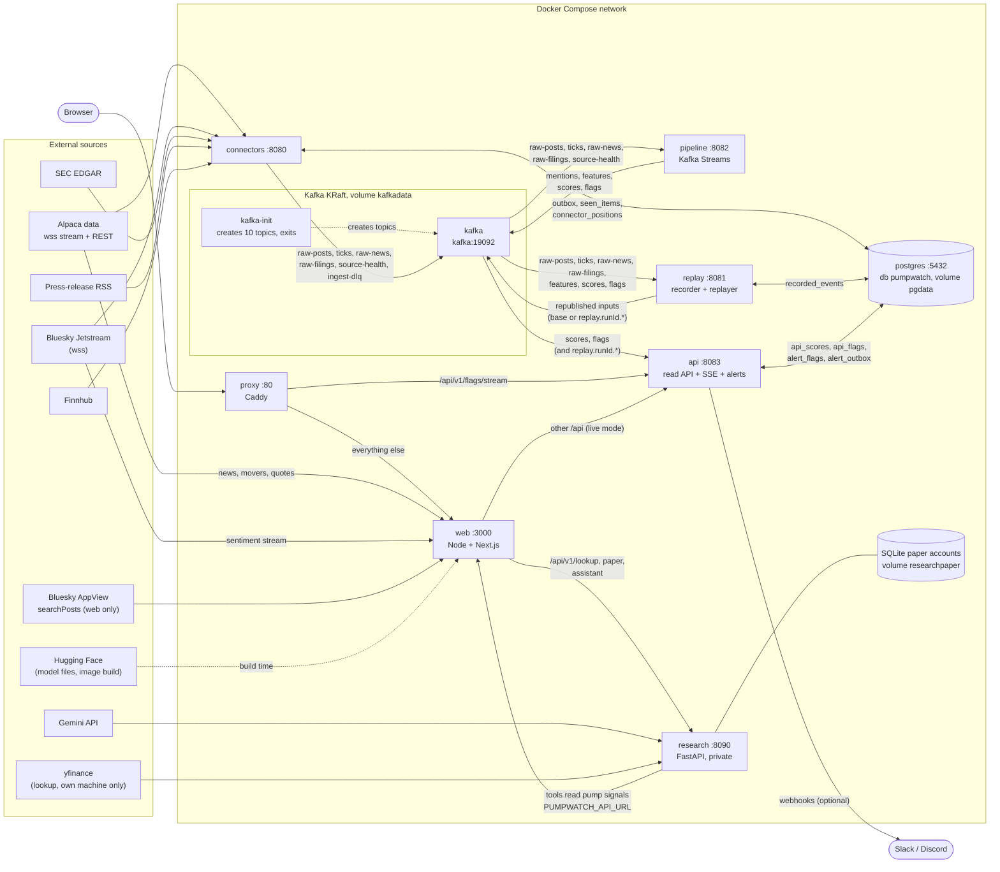

# Containers and how they connect

This page shows the Docker Compose stack: what each container does, which Kafka topics and
database tables sit between them, and how one trade or post becomes a flag on screen. Every
name below comes from `docker-compose.yml`, the Dockerfiles, the `application.yml` files and
`common/.../Topics.java`. For the logic inside each service (windows, scoring, sentiment) see
[overview.md](overview.md).

## Diagram



Dotted lines are one-off or build-time. Solid lines are runtime traffic. Postgres has no
connection from `pipeline`, `web` or `research`. The web and research containers publish no host
port; the browser reaches them only through `proxy`.

## Containers

Profile `apps` starts everything except `kafka`, `kafka-init` and `postgres`, which always start.
Host ports are bound to `127.0.0.1` except the proxy, which uses `PROXY_BIND` (default
`127.0.0.1`) and `PROXY_PORT` (default `80`). Env var names only; values live in `.env` or the
Compose file.

| Container | Image / build | Host port | Reads | Writes | Health | Key env vars |
| --- | --- | --- | --- | --- | --- | --- |
| `kafka` | `apache/kafka:3.9.1`, single node, KRaft | `127.0.0.1:9092` (inside Compose: `kafka:19092`) | all topics | all topics, volume `kafkadata` | `kafka-broker-api-versions.sh` | `KAFKA_*` (set in Compose) |
| `kafka-init` | `apache/kafka:3.9.1`, runs once | none | none | creates `raw-posts`, `ticks`, `raw-news`, `raw-filings`, `ingest-dlq`, `mentions`, `features`, `scores`, `flags`, `source-health` | exits 0 (`service_completed_successfully`) | `TOPIC_PARTITIONS` (default 6) |
| `postgres` | `postgres:17` | `127.0.0.1:5432` | n/a | volume `pgdata`, database `pumpwatch` | `pg_isready` | `POSTGRES_USER`, `POSTGRES_PASSWORD` |
| `connectors` | root `Dockerfile`, `MODULE=connectors` (Maven build, `eclipse-temurin:21-jre`) | `127.0.0.1:8080` | Alpaca, Bluesky Jetstream, Alpaca News, SEC EDGAR, Finnhub, RSS | Postgres: `outbox`, `seen_items`, `connector_positions`, `sec_company_tickers`, `rss_feed_state`, `finnhub_state`. Kafka: `raw-posts`, `ticks`, `raw-news`, `raw-filings`, `source-health`, `ingest-dlq` | `/actuator/health` | `WATCHLIST`, `ALPACA_ENABLED`, `ALPACA_KEY_ID`, `ALPACA_SECRET_KEY`, `ALPACA_FEED`, `ALPACA_NEWS_ENABLED`, `BLUESKY_ENABLED`, `BLUESKY_JETSTREAM_URL`, `SEC_ENABLED`, `SEC_USER_AGENT`, `FINNHUB_ENABLED`, `FINNHUB_TOKEN`, `RSS_ENABLED`, `RSS_FEEDS`, `KAFKA_BOOTSTRAP`, `POSTGRES_URL` |
| `replay` | root `Dockerfile`, `MODULE=replay` | `127.0.0.1:8081` | Kafka: `raw-posts`, `ticks`, `raw-news`, `raw-filings`, `features`, `scores`, `flags`; Postgres `recorded_events` | Postgres `recorded_events`; Kafka (replayed inputs) | `/actuator/health` | `REPLAY_PORT`, `KAFKA_BOOTSTRAP`, `POSTGRES_URL` |
| `pipeline` | root `Dockerfile`, `MODULE=pipeline` | `127.0.0.1:8082` | Kafka: `raw-posts`, `ticks`, `raw-news`, `raw-filings`, `source-health`, `mentions`, `features`, `scores` | Kafka: `mentions`, `features`, `scores`, `flags`; Streams internal topics; local state dir `/tmp/pumpwatch-streams` (no volume) | `/actuator/health` | `WATCHLIST`, `PIPELINE_PORT`, `STREAMS_REPLICATION`, `STREAMS_STATE_DIR`, `PIPELINE_MODEL_DIR`, `PIPELINE_VOL_MODEL_DIR`, `KAFKA_BOOTSTRAP` |
| `api` | root `Dockerfile`, `MODULE=api` | `127.0.0.1:8083` | Kafka `scores`, `flags` (also `replay.<runId>.scores/flags`); Postgres read tables | Postgres: `api_scores`, `api_flags`, `alert_flags`, `alert_outbox`; webhooks when alerts are on | `/actuator/health` | `API_PORT`, `API_ALLOWED_ORIGINS`, `API_RATE_LIMIT_PER_MINUTE`, `API_TRUSTED_PROXIES`, `ALERTS_ENABLED`, `ALERTS_WEBHOOK_URLS`, `ALERTS_LINK_BASE`, `ALERTS_COOLDOWN`, `ALERTS_MAX_PER_MINUTE`, `KAFKA_BOOTSTRAP`, `POSTGRES_URL` |
| `web` | `web/Dockerfile` (Node 22, Next.js build, runs `server.mjs`; pinned models fetched at build) | none (listens on 3000 inside the network) | `api` (via `API_ORIGIN`), `research` (via `RESEARCH_ORIGIN`), Alpaca news/movers/quotes, Jetstream, Bluesky AppView search | nothing durable; sentiment windows are in memory | Docker `HEALTHCHECK` fetching `/` | `DATA_MODE`, `API_ORIGIN`, `RESEARCH_ORIGIN`, `TRUST_PROXY_HEADERS`, `WATCHLIST`, `ALPACA_KEY_ID`, `ALPACA_SECRET_KEY`, `ALPACA_FEED`, `SENTIMENT_ENABLED`, `NEWS_SENTIMENT_ENABLED`, `SENTIMENT_MODEL_DIR` |
| `research` | `research/Dockerfile.service` (Python 3.13, FastAPI/uvicorn, Chroma library built into the image) | none (8090 inside the network) | `web` (via `PUMPWATCH_API_URL`), Gemini, yfinance when mock data is off | SQLite paper accounts on volume `researchpaper` (`/data`) | `/healthz` | `USE_MOCK_DATA` (set from `RESEARCH_USE_MOCK_DATA`), `USE_MOCK_LLM`, `GEMINI_API_KEY`, `GEMINI_MODEL`, `PUMPWATCH_API_URL` |
| `proxy` | `caddy:2-alpine`, mounts `deploy/Caddyfile` | `${PROXY_BIND:-127.0.0.1}:${PROXY_PORT:-80}` | `web`, `api` | nothing | none (waits for `web` and `api` healthy) | `PROXY_BIND`, `PROXY_PORT` |

Notes:

- The four Java images are one `Dockerfile` built four times with `MODULE` and `PORT` build args.
  The connectors, replay and api containers share one Postgres database but keep separate Flyway
  history tables (`flyway_history_connectors`, `flyway_history_replay`, `flyway_history_api`).
  The pipeline uses no Postgres.
- `web` bakes `API_ORIGIN` into the Next.js rewrite at build time, so rebuild it after changing
  that value. `web` also reads the root `.env` through `env_file`.
- Hugging Face is contacted only while the `web` image is built (pinned revisions of FinTwitBERT,
  the CardiffNLP irony model and Financial DistilRoBERTa). At runtime the model files are local.
- The `research` image also downloads Chroma's embedding model at build time. Gemini is called
  only when a key is present and `USE_MOCK_LLM` allows it.

## Browser path

1. The browser talks only to `proxy` (Caddy, port 80).
2. `GET /api/v1/flags/stream` (the SSE flag stream) goes straight to `api:8083` with no buffering,
   so no Node hop is held per open stream.
3. Everything else goes to `web:3000` (gzip on). `server.mjs` handles `/api` requests in this order:
   - `assistant` routes (`/api/v1/assistant/...`) and `lookup`/`paper` routes
     (`/api/v1/lookup/...`, `/api/v1/paper/...`) are validated, rate limited and forwarded to
     `research` at `RESEARCH_ORIGIN` (answered with 503 if it is unset).
   - In `DATA_MODE=mock`, every other `/api` request is answered by the built-in mock API.
   - In `DATA_MODE=live`, the context routes (movers, quotes, news, per-ticker news and sentiment)
     are answered by Node itself; the rest (`/api/v1/watchlist`, timelines, flags) falls through
     to Next.js, whose rewrite proxies `/api/:path*` to `API_ORIGIN` (`http://api:8083`).
4. `research` calls back into `web` (`PUMPWATCH_API_URL`) so assistant tools read the same pump
   signals, sentiment and news as the dashboard.
5. `replay` (`POST /replays` on 8081) is not routed by Caddy or the web proxy. It is reachable only
   from the host's loopback.

## Life of one event

### A trade becomes a flag

1. `connectors` holds the Alpaca websocket (`wss://stream.data.alpaca.markets/v2/...`) for the
   `WATCHLIST` symbols. It needs `ALPACA_ENABLED=true` and keys.
2. The tick is validated and inserted into the Postgres `outbox`. The publisher deletes the row only
   after Kafka acknowledges it, and a full outbox stops fetching instead of dropping records.
   Invalid records go to `ingest-dlq`.
3. The record lands on `ticks`, keyed by ticker. Connector health is sent to `source-health` every 15 s.
4. `pipeline` (Kafka Streams, `exactly_once_v2`) reads `ticks` in the feature stage, building 1-, 5- and
   30-minute event-time windows into `features`.
5. The scorer reads `features` plus `source-health` and writes a `scores` record. The default
   `rules-v1` scorer reads the five-minute window.
6. The flag stage reads `scores` and `features`. When the score reaches `flag-level` (60) and the
   cooldown allows it, it writes a record with its evidence to `flags`.
7. `api` has a Kafka listener on `scores` and `flags` and inserts into `api_scores` and `api_flags`.
   Topic, partition and offset make a repeated delivery harmless.
8. `SseHub` polls `api_flags` (every second), and pushes the flag over SSE to the browser. The browser
   path is `api` -> `proxy` -> browser. `/api/v1/watchlist` and the timeline are REST reads of the same tables.
9. The alert scheduler reads new live flags from `api_flags`, writes `alert_flags` and `alert_outbox`,
   and posts to the webhook URLs when `ALERTS_ENABLED=true`. Replay-run flags are excluded.

### A post becomes part of the same flag

1. `connectors` reads the public Bluesky Jetstream (`BLUESKY_ENABLED=true`), keeps only posts that
   mention a watchlist ticker, and reduces them (hashed author, tickers, SimHash, timestamps).
2. The record goes through the outbox to `raw-posts`.
3. `pipeline` mention extractor reads `raw-posts` and writes `mentions`. The feature stage joins
   `mentions` with `ticks`, `raw-news` and `raw-filings` (the catalysts) into `features`.
4. From there the path is the same as for a trade: `scores`, `flags`, `api`, SSE, alert.

A news item or SEC 8-K enters the same way through `raw-news` or `raw-filings`; a recent one counts as
a catalyst and lowers the score.

The web sentiment panel is a separate path and does not use Kafka: `web` reads Jetstream or the
Bluesky AppView search itself, classifies the text with the local ONNX models, and keeps only counts
in memory. It does not change the risk score.

## Record and replay

- The recorder in `replay` listens (group `pumpwatch-recorder`) to `raw-posts`, `ticks`,
  `raw-news`, `raw-filings`, `features`, `scores` and `flags`, and writes each record to
  Postgres `recorded_events` with its event time and Kafka partition and offset. It skips records
  that carry the replay header, so it never records its own output. A post deletion marker removes
  that post's rows.
- `POST http://127.0.0.1:8081/replays` with `from`, `to`, `speed` and `isolated` starts a run and
  returns a run ID. The replayer reads `recorded_events` in event-time order and republishes only
  the inputs. It skips the derived topics (`mentions`, `features`, `scores`, `flags`), which the
  pipeline recomputes.
- `isolated: false` (the default) publishes to the base topics, so the running `pipeline` scores
  the replay and `api` stores it, marked with the run ID. This mixes with live processing state.
- `isolated: true` publishes to `replay.<runId>.<topic>`. The `api` listener subscribes to those
  topic names for `scores` and `flags`, but `pipeline` consumes only the base topics, so nothing
  scores an isolated run unless extra wiring is added.
- Requests without a `runId` read live data only.

## Startup order and commands

Compose enforces this order with `depends_on` health conditions:

1. `kafka` and `postgres` start and pass their health checks.
2. `kafka-init` runs once and creates the topics (`TOPIC_PARTITIONS` partitions, replication 1).
3. `connectors`, `replay` and `api` wait for `kafka`, `postgres` and `kafka-init`. `pipeline` waits for
   `kafka` and `kafka-init`.
4. `web` and `research` have no `depends_on`; `web` starts independently and `research` only reaches
   `web` when the assistant calls a tool.
5. `proxy` starts last, after `web` and `api` are healthy.

```bash
cp .env.example .env                                   # first time only
docker compose --profile apps up -d --build            # everything
docker compose --profile apps up -d --build --wait     # same, wait until healthy
docker compose up -d                                   # only kafka, kafka-init, postgres
docker compose --profile apps down                     # stop; volumes are kept
docker compose --profile apps down -v                  # also delete volumes (all data)
```

Open `http://localhost/` (the proxy). The Java services answer on their loopback ports
(`curl http://127.0.0.1:8083/actuator/health`). `scripts/dev-up.sh --apps` starts only infra plus
`connectors replay pipeline api`, with no web, research or proxy.

Git Bash on Windows rewrites paths that start with `/`. Set `MSYS_NO_PATHCONV=1` for `docker exec`
and `docker compose exec` commands, for example:

```bash
MSYS_NO_PATHCONV=1 docker compose exec kafka /opt/kafka/bin/kafka-topics.sh --bootstrap-server kafka:19092 --list
```

Use `127.0.0.1`, not `localhost`, in local scripts: Node resolves `localhost` to `::1`.

## DATA_MODE: mock or live

`DATA_MODE` is read by the `web` container only (default `mock` from `.env` or the Compose default).

| | `mock` | `live` |
| --- | --- | --- |
| Dashboard data | Built-in mock API answers `/api`, labelled MOCK | Context routes from Alpaca (keys needed); scores and flags proxied from `api` |
| Kafka and Postgres | Not used by the web path; Java services run but nothing is published unless a source is enabled | Used through `api` |
| Sentiment | Off | On only with `SENTIMENT_ENABLED=true`; news tone with `NEWS_SENTIMENT_ENABLED=true` |
| Mock records into Kafka | Never | Never |

Other switches are independent of `DATA_MODE`:

- Java sources are all off by default. `ALPACA_ENABLED`, `ALPACA_NEWS_ENABLED`, `BLUESKY_ENABLED`,
  `SEC_ENABLED`, `FINNHUB_ENABLED` and `RSS_ENABLED` each start one connector.
- `research` prices lookups from `RESEARCH_USE_MOCK_DATA` (default `1`, mock; `0` uses yfinance) and
  answers with Gemini only if `GEMINI_API_KEY` is set and `USE_MOCK_LLM` is not forced to mock.
  In live mode the paper-trading fill price comes from the web server's own Alpaca quote.
- The public VM (`deploy/up.sh`) strips `ALPACA_` and `GEMINI_` lines from `.env`, forces
  `DATA_MODE=mock` (unless `DEPLOY_DATA_MODE=live` for load tests), `RESEARCH_USE_MOCK_DATA=1` and
  `USE_MOCK_LLM=1`. Real Alpaca data stays on the owner's machine.
