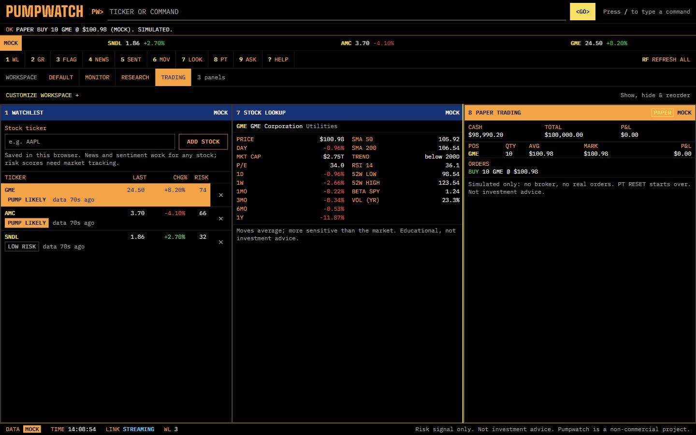

# Stock lookup, paper trading and the research assistant

The pump watch is the product. The private Python service in `research/` provides stock lookup, paper trading and a read-only research assistant around the pump panels: paper trading is the `/paper` tab and the assistant is a chat at the bottom right of the `/live` terminal.

- **Stock lookup.** `LOOK GME` (alias `DES GME`) fills panel 7 with the name, sector, price, daily move, market cap and P/E, price performance, SMAs, RSI, 52-week range, beta and volatility, from the pure numpy/pandas code in `research/src/portfolio_risk/risk/`.
- **Paper trading.** `BUY GME 10`, `SELL GME 10`, `PT` and `PT RESET` (then `PT RESET CONFIRM`) work from the terminal command line, and the Paper tab (`PT`) shows the account with an order form, marked PAPER: cash, positions, P&L and order history. Whole shares, no shorting, integer cents, atomic updates.
- **Anonymous.** No sign-in. Your browser makes a random account token, keeps it in localStorage and sends it in a header; the service stores only its hash, in SQLite on the `researchpaper` volume. Clear your browser data and the account is gone.
- **Server-decided prices.** The browser never sends a price. Mock mode fills at the service's mock close. Live mode (your own machine only) fills at the web server's own Alpaca quote, and the order is refused if there is none. Lookups in live mode use yfinance.
- **One origin.** The browser only calls `/api/v1/lookup` and `/api/v1/paper` on the web server, which validates, rate limits and forwards to the private `research` service (apps profile, no published port). Caddy is unchanged and the flag stream still bypasses Node.
- **Public data policy.** `deploy/up.sh` keeps the VM on mock data, so every public figure is labelled MOCK. Real data stays on your machine: set `DATA_MODE=live` with Alpaca keys, and `RESEARCH_USE_MOCK_DATA=0` for yfinance lookups.

> **This is simulated trading, not advice.** There is no broker, no real order and no real money, and nothing here is investment advice. Pumpwatch is a non-commercial project.




Mock mode, 1440x900. Mock prices do not move, so a mock buy then sell returns the same cash with zero P&L.

Run it locally with the `apps` profile (`docker compose --profile apps up -d --build`), or without Docker: `cd research`, `pip install -e ".[dev]"` on Python 3.13, `USE_MOCK_DATA=1 uvicorn api.service:app --port 8090`, then start the web server with `RESEARCH_ORIGIN=http://127.0.0.1:8090`. CI lints all of `research/` with ruff and runs its tests on Python 3.13.

## Research assistant (Gemini, MCP and RAG)

Type `ASK Is GME being pumped?`, or open the chat with `ASK` or `AI`.
Answers identify the answering agent (Gemini or the rule-based mock), data mode,
tools used and retrieved sources. The assistant can read stock snapshots, price
performance, technical indicators, news, pump signals, sentiment and your own paper
account. Its MCP tools are read-only: it cannot place orders.

Docker Compose starts the private Research service and connects its tools to the web
host. Without a key it uses the mock agent. For local Gemini use, add your own
`GEMINI_API_KEY` to the root `.env`; `USE_MOCK_LLM=auto` selects Gemini when the key
is present. `GEMINI_MODEL` defaults to `gemini-3.6-flash` and can be overridden.
Set `USE_MOCK_LLM=1` to force mock answers. Restart the service after configuration
changes. Gemini failures fall back to the mock agent with an explanatory note.
Public VM deployments remove Gemini settings and force the mock agent; AWS also
uses mock data and the mock agent without a key.

The Chroma library embeds the bundled Markdown seed documents with local ONNX
all-MiniLM-L6-v2. Docker builds both this library and the pinned Financial
DistilRoBERTa sentiment model ahead of time; the first build downloads their public
weights. Social posts use FinTwitBERT plus CardiffNLP possible irony; optional news
headline tone uses Financial DistilRoBERTa. Sentiment stays separate from the rules risk score.

For a non-Docker setup on Python 3.13, install `research/` with `pip install -e ".[dev]"`,
then run these commands from that directory:

```bash
python -m portfolio_risk.rag.ingest
python -m evals.run_evals --agent mock
USE_MOCK_DATA=1 USE_MOCK_LLM=1 PUMPWATCH_API_URL=http://127.0.0.1:3000 uvicorn api.service:app --port 8090
```

Start the web host with `RESEARCH_ORIGIN=http://127.0.0.1:8090`. The evaluation gate
checks tool selection, numeric accuracy, groundedness and retrieval against checked-in
thresholds. CI builds the seed library and runs this gate with the mock agent; it
does not need Gemini credentials.

