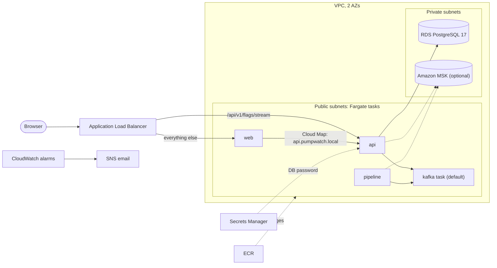

# Deploy to AWS

The stack runs on ECS Fargate behind an Application Load Balancer, with RDS PostgreSQL and either a single-node Kafka task (default) or Amazon MSK. Terraform is in `infra/aws/`, the scripts are `deploy/aws-up.sh` and `deploy/aws-down.sh`. This is a disposable test deployment, not production. The Google Cloud VM path (`docs/operations/gcp.md`) is unchanged.

**Warning: nothing here is free once it runs.** The load balancer, RDS, Fargate tasks and public IPv4 addresses bill by the hour from the moment they exist, whether or not anyone visits. Destroy the stack when you finish (`deploy/aws-down.sh`).

## What runs

| Piece | Choice |
| --- | --- |
| Network | VPC, 2 AZs, public subnets (ALB and tasks) and private subnets (RDS, MSK). No NAT Gateway: tasks get public IPs to pull images, and their security groups accept traffic only from the ALB or each other. |
| Services (ECS Fargate) | `web`, `api`, `pipeline` (1 task each), `kafka` (unless MSK is on). `connectors` and `replay` exist at **0 tasks**: with mock data and no Alpaca keys every source is off, so connectors would idle, and replay only re-plays events that connectors recorded. Raise `connectors_desired_count` / `replay_desired_count` to switch them on. `research` only with `enable_research = true`. |
| Discovery | Cloud Map namespace `pumpwatch.local`: `web` reaches `api.pumpwatch.local:8083`, apps reach `kafka.pumpwatch.local:19092`. |
| Load balancer | `/api/v1/flags/stream` goes straight to `api` (through the web server it broke SSE); everything else goes to `web`. Idle timeout 120 s against the API's 15 s heartbeat. Health checks: `/` for web, `/actuator/health` for api. HTTP on the ALB name, or HTTPS with an ACM certificate when `domain_name` and `route53_zone_id` are set. |
| Database | RDS PostgreSQL 17, `db.t4g.micro`, encrypted, private, 1-day backups, no deletion protection, no final snapshot. |
| Secrets | The DB password is generated by Terraform (`random_password`), stored in Secrets Manager and injected through the ECS `secrets` block. It is also in `terraform.tfstate`, so treat the state file as a secret (local state is gitignored; an S3 backend must be encrypted). RDS-managed passwords would keep it out of state but rotate weekly and break running tasks, which is worse for a short-lived test. |
| Images | One ECR repository per image; Kafka (`apache/kafka:3.9.1`) is mirrored into ECR so Fargate avoids Docker Hub pull limits. |
| Observability | One CloudWatch log group (7 days), a dashboard, alarms (ALB 5xx, target response time, ECS CPU and memory, RDS free storage) to an SNS topic, and an AWS Budgets alarm (default 25 USD). |
| Scaling | CPU target tracking for `web` and `api`, min 1, max 3. |

## Kafka: two modes

- **Default (`enable_msk = false`)**: one `apache/kafka` KRaft task with the same settings as `docker-compose.yml`. A sidecar container creates the topics from the compose list (`raw-posts`, `ticks`, `raw-news`, `raw-filings`, `ingest-dlq`, `mentions`, `features`, `scores`, `flags`, `source-health`) and runs again on every restart. **Its data lives on the task's ephemeral disk and is lost whenever the task restarts or is replaced**, including every deploy of that service. Fine for mock data, wrong for anything you need to keep.
- **`enable_msk = true`**: Amazon MSK provisioned, 2 `kafka.t3.small` brokers (one per AZ), PLAINTEXT inside the VPC, so no application change. Topics are created by a one-off Fargate task that `deploy/aws-up.sh` runs; MSK also has `auto.create.topics.enable=true` as a fallback. It is the biggest cost line, so it is off by default. The Kafka version `3.9.x` and instance type were not checked against the live API (no credentials were used).

## Client addresses behind the ALB

The ALB runs with `xff_header_processing_mode = append`: it adds the address it saw to the **end** of `X-Forwarded-For`, even when the client sent its own value. `web/server-headers.mjs` takes the right-most entry when `TRUST_PROXY_HEADERS=true`, which is therefore the real client and cannot be forged. That setting is on for `web`, whose only peer is the ALB. The stream route skips the web server, so the API sees the ALB directly: Tomcat's remote-IP handling (`API_TRUSTED_PROXIES`) is set to a regex covering only the VPC range (`10\.20\.\d+\.\d+`, derived from `vpc_cidr`), so it skips the ALB and web hops and stops at the right-most untrusted entry, the real client.

## Data policy

Tasks run `DATA_MODE=mock`, with every Alpaca source disabled and no Alpaca or Anthropic keys anywhere in Terraform, variables or the scripts. Real market data stays on your machine (`docs/data/sources.md`). For a load test only, set `data_mode = "live"`: the web server then proxies `/api` to the Java API, still with no keys and only `load/seed.sql` data. Set it back to `mock` afterwards.

## Prerequisites

- An AWS account you control, AWS CLI v2 with credentials in your shell (`aws sso login` or `aws configure`), Terraform 1.9+, Docker.
- Copy `infra/aws/terraform.tfvars.example` to `infra/aws/terraform.tfvars` and set at least `alarm_email` and `budget_email`. Narrow `allowed_cidrs` to your own `/32` if the site should not be public.

## Create

```bash
deploy/aws-up.sh
```

It runs `terraform apply` (you approve the plan), builds the images for `linux/amd64`, pushes them to ECR, creates the MSK topics if MSK is on, forces a new deployment of each service, waits until they are stable, then checks the site and the flag stream. ECS retries image pulls until the images exist, so the order is safe. The first run takes about 20 to 30 minutes, most of it RDS, the Maven builds and (if on) MSK.

The `web` image bakes its API address in at build time (`API_ORIGIN=http://api.pumpwatch.local:8083`). If you change `name`, rebuild `web`.

## Verify

```bash
deploy/ready.sh "$(terraform -chdir=infra/aws output -raw url)"
curl -N -m 5 "$(terraform -chdir=infra/aws output -raw url)/api/v1/flags/stream"   # expect 200 and SSE comments
```

Check the CloudWatch dashboard `pumpwatch` and confirm the SNS email subscription.

## Load test

Set `data_mode = "live"` and `api_rate_limit_per_minute = 100000` in `terraform.tfvars`, add `api_extra_env = { API_MAX_STREAMS = "2000", API_MAX_STREAMS_PER_CLIENT = "2000" }` for a capacity run, and `terraform -chdir=infra/aws apply`. Seed data: the database is private, so run `load/seed.sql` from a one-off task or a temporary bastion (not automated here). Then, from another machine:

```bash
BASE=$(terraform -chdir=infra/aws output -raw url) VUS=100 CONNS=1000 RATE_LIMIT=100000 load/run.sh
```

Quote the Fargate sizes (api 0.5 vCPU / 1 GB), autoscaling max and rate limit with any number. Revert `data_mode` and the rate limit afterwards.

## Destroy

```bash
deploy/aws-down.sh
```

Then check the console for leftovers (ECS, load balancers, RDS, MSK, public IPs) and your Budgets email. ECR repositories are force-deleted with their images.

## Manual GitHub deploy (optional)

`.github/workflows/aws-deploy.yml` runs only when you start it from the Actions tab (`workflow_dispatch`, and you must type `deploy`). It never runs on push, and the normal `ci.yml` has no AWS steps beyond `terraform fmt` and `validate` with no credentials. To use it: set `enable_github_oidc = true`, apply, then set repository variables `AWS_DEPLOY_ROLE_ARN`, `AWS_REGION`, `WEB_API_ORIGIN` from the Terraform outputs. The role trusts only `repo:RLinV1/PumpDump:ref:refs/heads/main` (`github_oidc_subjects`) and can push to the ECR repositories and update the ECS services, nothing more.

## Research

`enable_research = true` adds the research assistant on mock data and the mock agent (no `ANTHROPIC_API_KEY`), registered in Cloud Map and wired to `web` through `RESEARCH_ORIGIN`. Its storage is ephemeral: if its paper-trading state must survive restarts, add an EFS file system and a `volume` mount to its task definition. Not done, because the stack is disposable. The image is built from `research/Dockerfile.service`.

## Cost estimate

**Estimates, not quotes.** Prepared 2026-11-06 for `us-east-1`, on-demand, 730 hours a month, 1 task per service, light traffic. Sources: [AWS Fargate pricing](https://aws.amazon.com/fargate/pricing/) (x86 $0.04048 per vCPU-hour, $0.004445 per GB-hour), third-party aggregators for the rest ([RDS db.t4g.micro $0.016/h](https://calculator.holori.com/aws/rds/db.t4g.micro), [MSK kafka.t3.small $0.0456/h](https://airbyte.com/data-engineering-resources/apache-kafka-pricing), [ALB $0.0225/h plus $0.008 per LCU-hour](https://www.cloudzero.com/blog/aws-alb-pricing/)). **Not confirmed on AWS's own pages:** the RDS, MSK and ALB rates (search returned secondary sources only), the public IPv4 rate of $0.005 per address-hour (from memory of AWS's 2024 change), and storage, CloudWatch and Secrets Manager figures. Check the AWS Pricing Calculator before relying on any of it.

| Item | Without MSK (USD/month) | With MSK (USD/month) |
| --- | --- | --- |
| Fargate `web` (0.25 vCPU, 0.5 GB) | 9 | 9 |
| Fargate `api` (0.5 vCPU, 1 GB) | 18 | 18 |
| Fargate `pipeline` (0.5 vCPU, 1 GB) | 18 | 18 |
| Fargate `kafka` (1 vCPU, 2 GB) | 36 | 0 |
| MSK, 2 x kafka.t3.small plus 20 GB | 0 | 69 |
| Application Load Balancer (hour plus about 1 LCU) | 22 | 22 |
| RDS `db.t4g.micro` plus 20 GB gp3 | 14 | 14 |
| Public IPv4 addresses (tasks plus ALB) | 22 | 18 |
| CloudWatch (logs, dashboard, alarms), Secrets Manager, ECR | 5 | 5 |
| **Total** | **about 144** | **about 173** |

That is roughly 0.20 USD an hour without MSK and 0.24 with it, so a four-hour test costs about a dollar; leave it running for a week and it costs about 33 to 40. The default 25 USD budget alarm trips after about five days. Optional extras: `connectors` or `replay` at one task add about 18 each; `research` about 36. Data transfer out, NAT (none used) and load-test traffic are not included.

## Not done

Not run: `terraform plan` and `apply` (no AWS credentials were used), so nothing has been deployed or verified against AWS. `tflint`, `checkov` and `actionlint` were not installed. Remote state, WAF, private subnets for tasks with a NAT Gateway, and EFS for Research are follow-ups.

## Diagram


