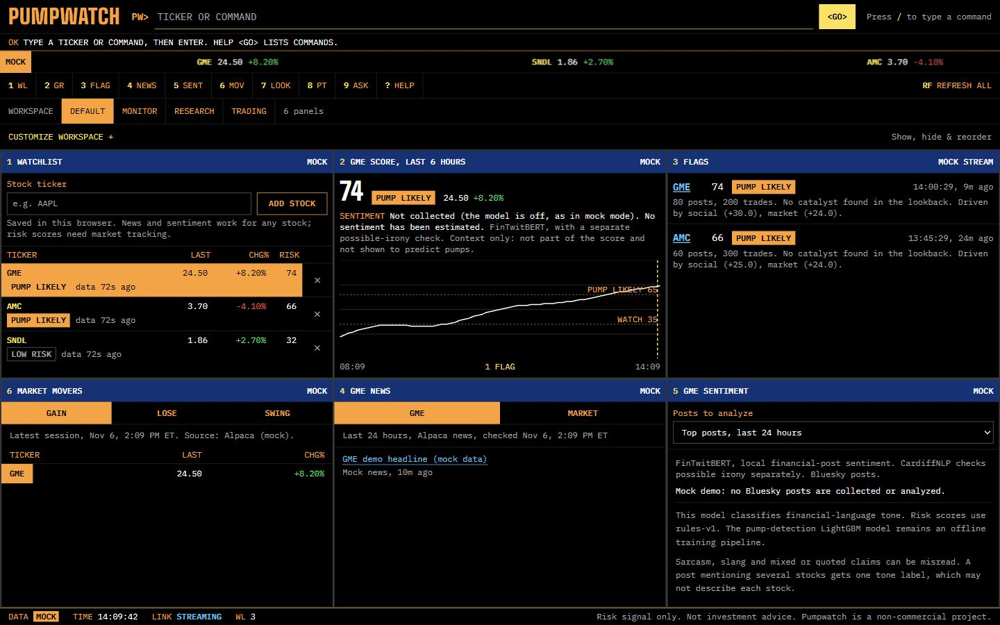
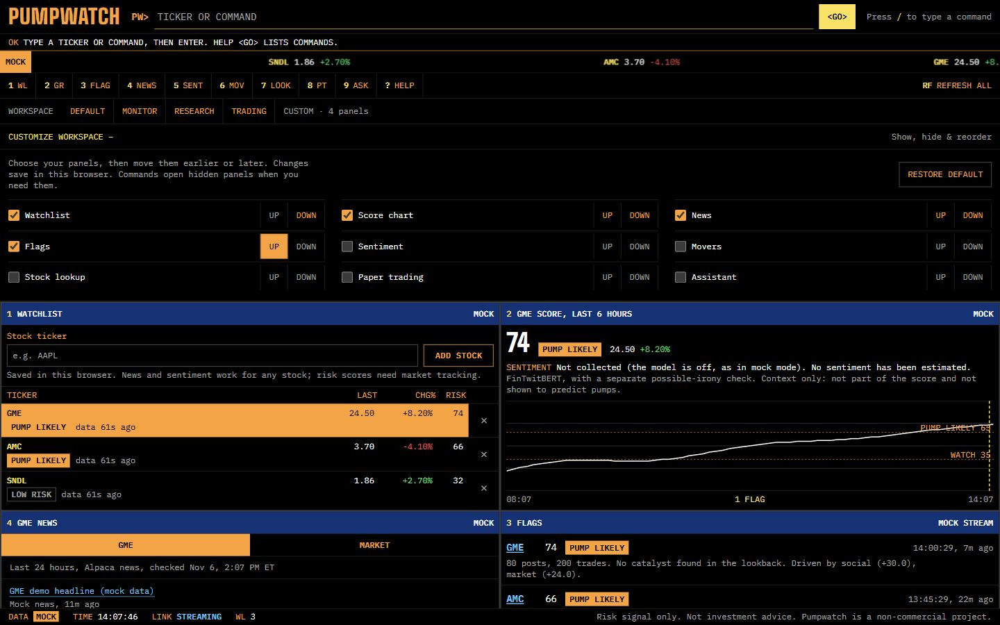
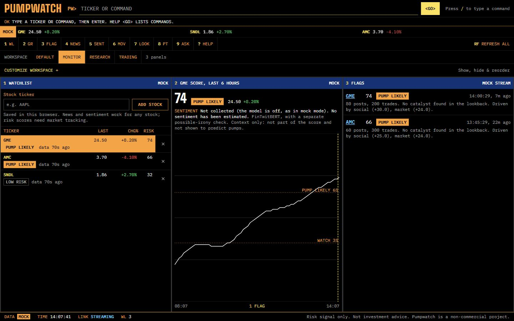
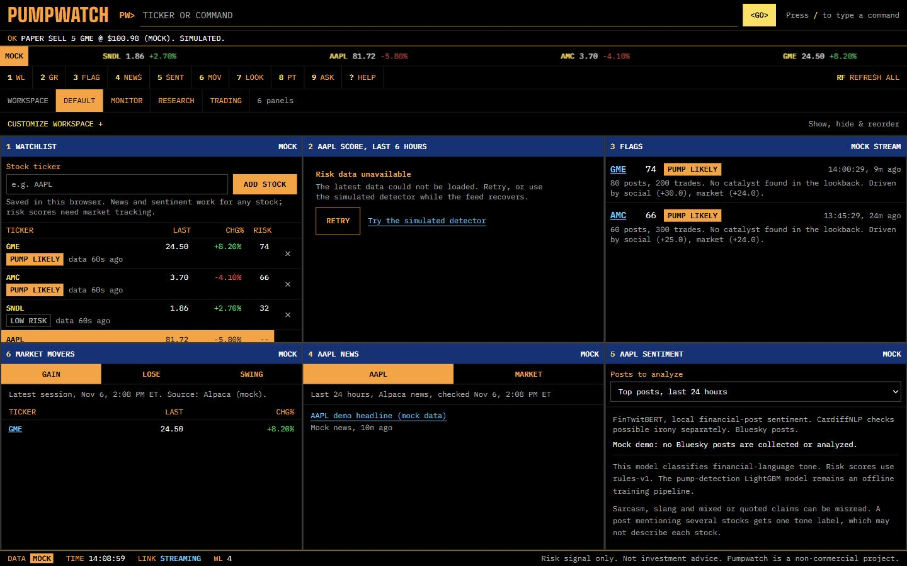
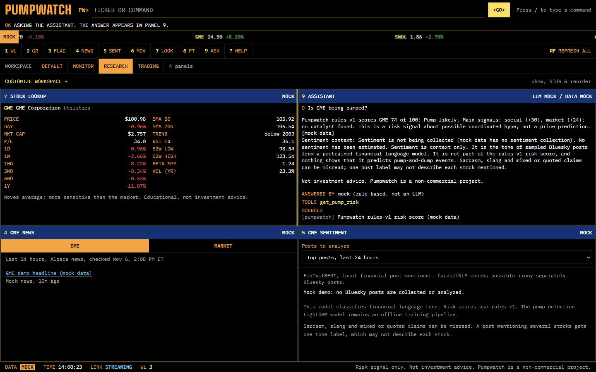
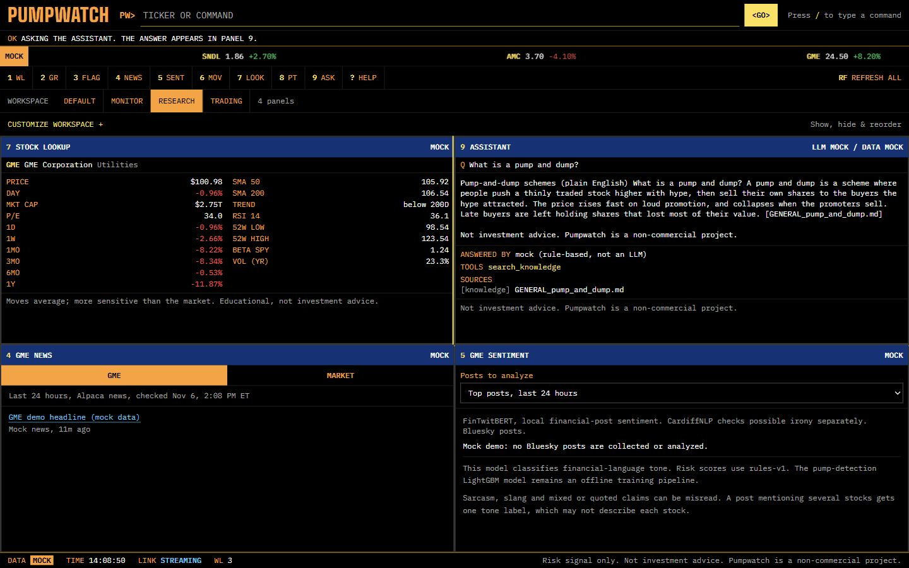
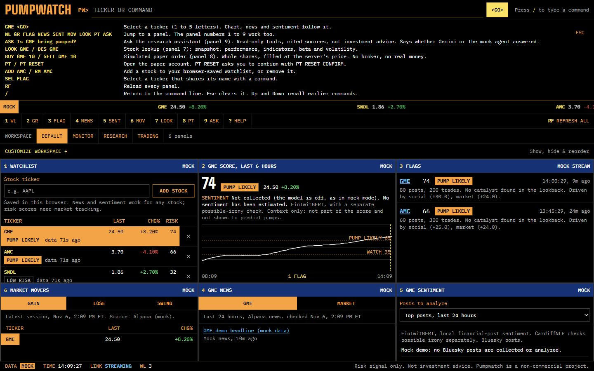
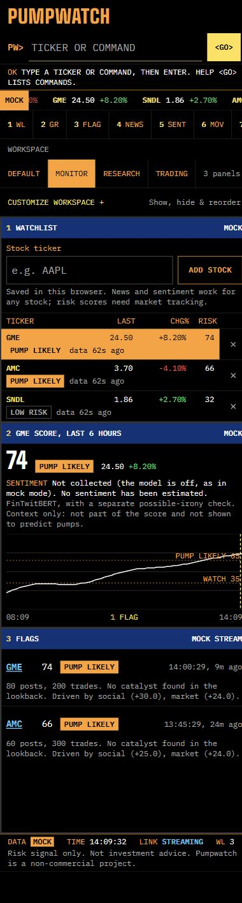
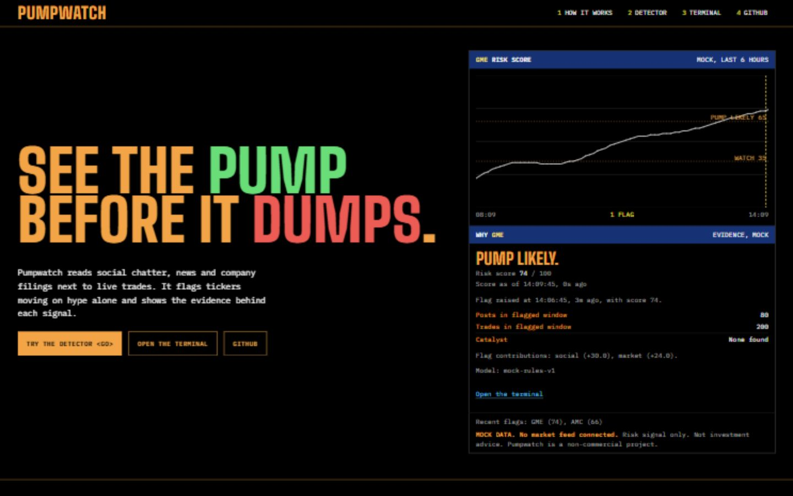

# App walkthrough

Screenshots come from the production UI with labelled MOCK data. Provenance: [img/README.md](../img/README.md).

The screenshots below come from the current production UI with labelled **MOCK** data.
Stock figures and orders are synthetic. The assistant uses its rule-based mock agent.
Live Bluesky collection is deliberately off in these screenshots; live mode uses the
local FinTwitBERT model and a separate possible-irony check rather than invented sentiment counts.

## Your workspace

Choose a starting layout, then open **Customize workspace** to show or hide panels
and move them up or down. Changes save in this browser, including across reloads.
**Restore default** brings back the standard layout. Commands automatically reveal
a hidden panel, so every feature remains reachable.

| Layout | Panels |
| --- | --- |
| Default | Watchlist, risk chart, flags, movers, news and sentiment |
| Monitor | Watchlist, risk chart and flags |
| Research | Stock lookup, news and sentiment |
| Custom | Your chosen panels in your chosen order |

## Pump-and-dump watch

The watchlist ranks tracked stocks by risk. Selecting a ticker updates the six-hour
score chart, news and sentiment. Flags show the triggering evidence, contributing
feature groups and whether a catalyst was found. The risk score uses rules-v1;
sentiment is separate context.

## Stock search and personal watchlist

Type a ticker to select it, use **Add stock** or `ADD AAPL` to save it in this browser,
and use `LOOK GME` or `DES GME` for the stock snapshot. Untracked stocks show
**No risk score yet**. Lookup includes performance, moving averages, RSI, beta,
volatility and the 52-week range.

## Research: news, sentiment and market movers

The Default layout includes stock/market news and gainers, losers and intraday
swings. Select any mover to inspect it. The Research layout pairs stock lookup with
ASK, news and the sentiment panel. Sentiment offers top posts or recent posts from
the last 24 hours, plus the live Bluesky stream. It analyzes Bluesky posts, not
X/Twitter tweets. Mock mode reports that collection is off; live mode reports the
actual classified sample and model status.

## Assistant, MCP tools and the knowledge library

`ASK Why is GME flagged?` reads the same risk signals as the dashboard, and the "Ask about this flag" action on a flag sends its evidence.
`ASK What is a pump and dump?` retrieves the local Chroma knowledge library.
Answers identify Gemini or the mock agent, data mode, tools and sources.
The assistant's MCP tools can read data; they cannot trade, and it never gives buy or sell advice.

## Keyboard commands and mobile

Type `HELP` to see the commands. `/` focuses the command line; the arrow keys recall
commands and Escape clears it. Workspace selection and customization also work on
phones, where panels stack in the saved order.

## Landing page and simulated detector

The landing page explains the inputs and scoring flow. Its interactive detector
lets readers compare coordinated hype with a move supported by a news catalyst.
The detector is a labelled simulation, separate from market analysis.

## Model checks and load tests

See [the model comparison and retained failures](../ml/sentiment-evaluation-2026-11-06.md)
and [the local performance/optimization report](../reports/performance-2026-11-06.md).
Use `SENTIMENT_ENABLED=true` in live mode for FinTwitBERT plus a separate possible-irony
count; use `NEWS_SENTIMENT_ENABLED=true` for Financial DistilRoBERTa headline tone.
The 46 synthetic social examples exposed sarcasm and negation errors. Neither model
is claimed to perfectly interpret posts, and possible irony never reverses tone labels.

